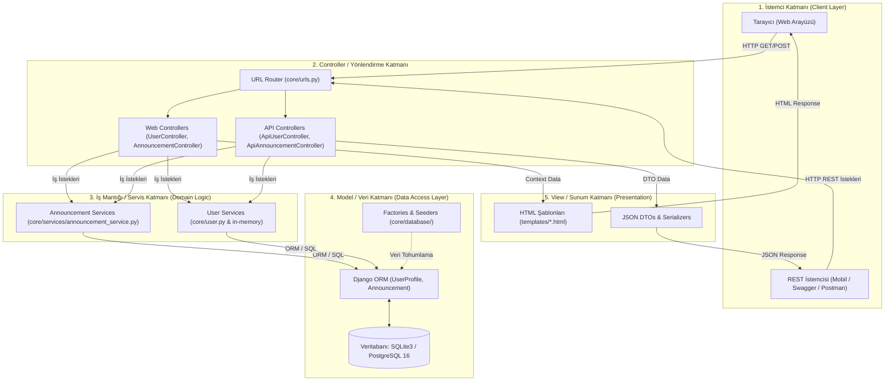

# 🎓 Alumni Portal (Alumni Management System)

[](https://www.python.org/)
[](https://www.djangoproject.com/)
[](https://www.postgresql.org/)
[](https://www.docker.com/)
[](./swagger.json)
[-7c3aed.svg)](./ddd.md)
[-brightgreen.svg)](#-test-ve-kalite-güvencesi)

> **Web Programlama (Web Programming)** dersi kapsamında geliştirilen; mezunlar, öğrenciler ve üniversite yönetimi arasında köprü kurmayı hedefleyen modern, modüler, veritabanı destekli ve yüksek standartlı bir **Mezun Yönetim Portalı** (Alumni Management Platform).

---

## 📌 İçindekiler

- [📖 Proje Hakkında ve Vizyon](#-proje-hakkında-ve-vizyon)
- [🏛️ Mimari Tasarım: Django MVT'den Temiz MVC'ye](#-mimari-tasarım-django-mvtden-temiz-mvcyeye)
  - [Sorumlulukların Ayrımı (Separation of Concerns - SoC)](#sorumlulukların-ayrımı-separation-of-concerns---soc)
  - [Katmanlı Mimari Şeması](#katmanlı-mimari-şeması)
- [📂 Proje Dizin Yapısı](#-proje-dizin-yapısı)
- [🛠️ Teknoloji Yığını](#️-teknoloji-yığını)
- [✨ Temel Özellikler](#-temel-özellikler)
- [🚦 Gerçekleştirilen Rotalar ve API Kataloğu](#-gerçekleştirilen-rotalar-ve-api-kataloğu)
  - [Web Kullanıcı Arayüzü Rotaları](#-web-kullanıcı-arayüzü-rotaları)
  - [REST API Uç Noktaları](#-rest-api-uç-noktaları)
- [🌱 Database Factory ve Idempotent Seeder Mimarisi](#-database-factory-ve-idempotent-seeder-mimarisi)
- [🐳 Docker ve Konteynerizasyon Altyapısı](#-docker-ve-konteynerizasyon-altyapısı)
- [🔐 Ortam Değişkenleri ve Güvenlik Önlemleri](#-ortam-değişkenleri-ve-güvenlik-önlemleri)
- [📐 Domain-Driven Database Design (`ddd.md`) Sözleşmesi](#-domain-driven-database-design-dddmd-sözleşmesi)
- [📄 Swagger / OpenAPI 3.0 Dokümantasyonu](#-swagger--openapi-30-dokümantasyonu)
- [💻 Yerel Kurulum ve Çalıştırma (Local Development)](#-yerel-kurulum-ve-çalıştırma-local-development)
- [🧪 Test ve Kalite Güvencesi](#-test-ve-kalite-güvencesi)
- [🧭 Geliştirici Kılavuzu ve Kod Standartları](#-geliştirici-kılavuzu-ve-kod-standartları)
- [🗺️ Yol Haritası (Roadmap)](#️-yol-haritası-roadmap)

---

## 📖 Proje Hakkında ve Vizyon

**Alumni Portal**, üniversite mezunlarının kariyer gelişimlerini desteklemek, mevcut öğrenciler ile mezunlar arasında mentorluk köprüleri kurmak, üniversite etkinlik ve duyurularını tek bir çatı altında toplamak amacıyla geliştirilmektedir.

Projede **Domain-Driven Design (DDD)** ilkeleri, **Temiz MVC mimarisi**, **kalıcı ilişkisel veritabanı (SQLite & PostgreSQL)**, **idempotent seeder altyapısı** ve **kapsamlı otomasyon testleri** (71 test) esastır.

---

## 🏛️ Mimari Tasarım: Django MVT'den Temiz MVC'ye

Geleneksel Django projeleri `views.py` dosyalarında aşırı kod birikmesine (*Fat Views anti-pattern*) yol açabilir. Projemizde kurumsal standartlarda **Temiz MVC (Model-View-Controller)** ve **Servis Katmanı (Service Layer)** uygulanmıştır:



### Sorumlulukların Ayrımı (Separation of Concerns - SoC)

| Klasik MVC | Django Karşılığı | Projedeki Konumu | Sorumluluk ve İlkeler |
| :--- | :--- | :--- | :--- |
| **Model (M)** | Model | `core/models.py` | **Veri & Şema Katmanı:** Veritabanı tabloları (`core_userprofile`, `core_announcement`), ORM kısıtları, indeksler ve veri bütünlüğü. |
| **View (V)** | Template & DTO | `templates/` & JSON DTO | **Sunum Katmanı:** HTML şablonları veya REST JSON DTO yanıtlarının hazırlanması. |
| **Controller (C)** | View & Controller | `core/controllers/` | **İstek Karşılama & Orkestrasyon:** HTTP fiillerini karşılar, yetkilendirmeyi ve servis çağrılarını yönetir. |
| **Service Layer** | Business Logic | `core/services/` | **İş Mantığı (Domain):** Validasyonlar, filtreleme algoritmaları, ACID transaction yönetimi (*Skinny Controller, Rich Service*). |

---

## 📂 Proje Dizin Yapısı

Standardize edilmiş proje mimarisi aşağıdaki şekilde organize edilmiştir:

```text
alumni/
├── manage.py                   # Django yönetim aracı (CLI)
├── requirements.txt            # Python bağımlılıkları (Django, psycopg2-binary vb.)
├── swagger.json                # OpenAPI 3.0 REST API spesifikasyon sözleşmesi
├── ddd.md                      # [DDD] Domain-Driven Database Design reçetesi & sözleşmesi
├── db.sqlite3                  # Yerel SQLite3 ACID veritabanı
├── db.sqlite3.backup           # Canlı veri koruma yedeği
├── Dockerfile                  # Container imaj tanımı (Python 3.11-slim)
├── docker-compose.yml          # Standart Docker Compose orkestrasyonu (Web + PostgreSQL)
├── docker_compose.yml          # Docker Compose alternatif alias dosyası
├── .dockerignore               # Container build context filtre kuralları
├── .env                        # [GİZLİ] Yerel ortam değişkenleri ve secret anahtarlar (chmod 600)
├── env.example                 # Ortam değişkenleri örnek şablonu
├── .example.env                # Alternatif ortam değişkenleri şablonu
├── .env.example                # Docker uyumlu ortam değişkenleri şablonu
├── .gitignore                  # Git sızıntı önleme ve dosya dışlama kuralları
├── README.md                   # Proje ana dokümantasyonu ve mimari rehber
│
├── core/                       # Çekirdek uygulama ve proje konfigürasyonu
│   ├── __init__.py
│   ├── apps.py                 # Core uygulama yapılandırması
│   ├── settings.py             # Akıllı veritabanı (Postgres/SQLite) ve güvenlik ayarları
│   ├── urls.py                 # Merkezi rota tanımları ve URL mapping
│   ├── admin.py                # Django Admin panel kayıtları (UserProfile & Announcement)
│   ├── models.py               # [ORM] UserProfile ve Announcement veritabanı modelleri
│   ├── views.py                # View yönlendirmeleri ve controller köprüleri
│   │
│   ├── controllers/            # [C] CONTROLLER KATMANI (Temiz MVC)
│   │   ├── user_controller.py             # UserController: Web HTML Kullanıcı CRUD
│   │   ├── api_user_controller.py         # ApiUserController: REST API Kullanıcı CRUD
│   │   ├── announcement_controller.py     # AnnouncementController: Web HTML Duyuru CRUD (DB Connected)
│   │   ├── api_announcement_controller.py # ApiAnnouncementController: REST API Duyuru CRUD (DB Connected)
│   │   ├── user_urls.py                   # Web User rotaları
│   │   ├── api_urls.py                    # REST API User rotaları
│   │   ├── announcement_urls.py           # Web Announcement rotaları
│   │   └── api_announcement_urls.py       # REST API Announcement rotaları
│   │
│   ├── services/               # [Service Layer] VERİTABANI SERVİS KATMANI
│   │   ├── __init__.py
│   │   └── announcement_service.py # Veritabanı Duyuru CRUD ve iş mantığı operasyonları
│   │
│   ├── database/               # [Factory & Seeder] VERİTABANI TOHUMLAMA MİMARİSİ
│   │   ├── __init__.py
│   │   ├── base.py             # BaseFactory ve BaseSeeder soyut sınıfları
│   │   ├── data_pools.py       # Zengin Türkçe isim, şehir, okul ve duyuru havuzları
│   │   ├── factories/          # Model Factories (UserProfileFactory, AnnouncementFactory)
│   │   └── seeders/            # Idempotent Seeders (User, Announcement, DatabaseSeeder)
│   │
│   ├── management/             # DJANGO CUSTOM CLI KOMUTLARI
│   │   └── commands/
│   │       └── seed.py         # `python manage.py seed` komutu
│   │
│   ├── migrations/             # Veritabanı şema göç dosyaları
│   │   ├── 0001_initial.py     # UserProfile tablosu göçü
│   │   └── 0002_announcement.py # Announcement tablosu göçü
│   │
│   └── tests.py                # Django test paketi (43 test: Model, View, Seeder, DB CRUD)
│
├── templates/                  # [V] VIEW KATMANI: HTML Görünümleri
│   ├── index.html              # Ana karşılama sayfası ve interaktif rota paneli
│   ├── about.html              # Proje hakkında bilgilendirme sayfası
│   ├── users.html              # Kullanıcı kayıt formu ve veri tablosu
│   ├── announcements.html      # Veritabanı destekli Duyuru Yönetim Paneli
│   └── swagger.html            # Canlı Swagger UI REST API dokümantasyon konsolu
│
├── model.py                    # Saf Python User domain modeli
├── user.py                     # In-memory User CRUD servisi
├── announcement_model.py       # Saf Python Announcement domain modeli
├── announcement.py             # In-memory Announcement CRUD servisi
├── test_controllers.py         # User Controller testleri (7 test)
├── test_announcements.py       # Announcement Controller in-memory testleri (9 test)
└── test_in_memory_user.py      # In-memory User CRUD testleri (12 test)
```

---

## 🛠️ Teknoloji Yığını

| Katman | Teknoloji | Açıklama |
| :--- | :--- | :--- |
| **Backend Dili** | [Python 3.11+](https://www.python.org/) | Tip güvenliği ve modern Python özellikleri |
| **Web Çatısı** | [Django 6.1+](https://www.djangoproject.com/) | Kurumsal seviye MVC web mimarisi |
| **İlişkisel Veritabanı** | [SQLite3](https://www.sqlite.org/) / [PostgreSQL 16](https://www.postgresql.org/) | Akıllı hibrit mimari: Yerelde SQLite3, Docker'da PostgreSQL |
| **Konteynerizasyon** | [Docker](https://www.docker.com/) & [Docker Compose](https://docs.docker.com/compose/) | İzole geliştirme ortamı ve mikro servis mimarisi |
| **Tohumlama & Test Verisi**| Custom Factory & Seeder | Modüler, tip güvenli ve %100 idempotent veri üretimi |
| **API Standartı** | [OpenAPI 3.0.0](https://swagger.io/specification/) | Endüstri standardı REST API şeması |
| **API Arayüzü** | [Swagger UI](https://swagger.io/tools/swagger-ui/) | Etkileşimli API test ve dokümantasyon konsolu |
| **Frontend** | HTML5, CSS3, JavaScript | Modern, duyarlı ve kullanıcı dostu arayüzler |
| **Test Çerçevesi** | Django Test Framework (unittest) | 71 otomatize birim ve entegrasyon testi (%100 Başarılı) |

---

## ✨ Temel Özellikler

- **🗄️ Veritabanı Destekli Çift Modüllü CRUD (Users & Announcements):**
  - Hem Kullanıcılar hem de Duyurular doğrudan ilişkisel veritabanına (`db.sqlite3` / PostgreSQL) bağlıdır.
  - Sunucu kapansa dahi veriler kalıcı olarak korunur.
- **🌱 Idempotent Veritabanı Seeder Mimarisi:**
  - Tekrarlı çalıştırmalarda mükerrer kayıt üretmeyen akıllı tohumlama sistemi (`python manage.py seed`).
- **🐳 Sıfır Konfigürasyonlu Docker Altyapısı:**
  - PostgreSQL 16 veritabanı, sağlık kontrolü (`healthcheck`), kalıcı volume ve canlı reload ile tek komutta hazır.
- **🔐 Kurumsal Güvenlik ve Gizlilik Standartları:**
  - Kriptografik anahtarlar, `.env` dosya izinleri (`chmod 600`), `.gitignore` ve `.dockerignore` sızıntı korumaları.
- **🧩 Çift Dilli Parametre Desteği:**
  - Hem formlarda hem API'da Türkçe (`isim`, `dogum_tarihi`, `sehir`, `okul`, `baslik`, `icerik`) ve İngilizce (`name`, `birth_date`, `city`, `school`, `title`, `content`) tam uyumluluk.
- **🛡️ Katı Validasyon & Hata Yönetimi:**
  - Karakter limitleri, eksik alan kontrolleri ve anlamlı HTTP durum kodları (`200`, `201`, `400`, `404`, `405`).

---

## 🚦 Gerçekleştirilen Rotalar ve API Kataloğu

### 🌐 Web Kullanıcı Arayüzü Rotaları

| Metot | Rota | Controller / View | CRUD Operasyonu | Çıktı / Şablon |
| :--- | :--- | :--- | :--- | :--- |
| `GET` | `/` | `home` | Landing Page | `templates/index.html` |
| `GET` | `/about/` | `about` | Bilgilendirme | `templates/about.html` |
| `GET` | `/users/` | `user_list_view` | **USER READ ALL:** Kullanıcı listesi & form | `templates/users.html` |
| `POST`| `/users/create/` | `user_create_view` | **USER CREATE:** Yeni kullanıcı kaydı | `templates/users.html` (`201`) |
| `GET` | `/users/<int:user_id>/` | `user_detail_view` | **USER READ SINGLE:** Tekil kullanıcı detayı | `templates/users.html` |
| `POST`| `/users/<int:user_id>/update/` | `user_update_view` | **USER UPDATE:** Kullanıcı güncelleme | `templates/users.html` |
| `POST`| `/users/<int:user_id>/delete/` | `user_delete_view` | **USER DELETE:** Kullanıcı silme | `templates/users.html` |
| `GET` | `/announcements/` | `AnnouncementController` | **ANNOUNCEMENT READ:** Duyuru listesi & arama | `templates/announcements.html` |
| `POST`| `/announcements/create/` | `AnnouncementController` | **ANNOUNCEMENT CREATE:** Veritabanına yeni duyuru | `templates/announcements.html` (`201`) |
| `GET` | `/announcements/<int:id>/` | `AnnouncementController` | **ANNOUNCEMENT DETAIL:** Tekil duyuru detayı | `templates/announcements.html` |
| `POST`| `/announcements/<int:id>/update/` | `AnnouncementController` | **ANNOUNCEMENT UPDATE:** Duyuru güncelleme | `templates/announcements.html` |
| `POST`| `/announcements/<int:id>/delete/` | `AnnouncementController` | **ANNOUNCEMENT DELETE:** Duyuru silme | `templates/announcements.html` |

### 🚀 REST API Uç Noktaları

| Metot | Rota | Açıklama | Başarılı Yanıt |
| :--- | :--- | :--- | :--- |
| `GET` | `/api/healt/` *(veya `/api/health/`)* | Sistem sağlık kontrolü (Health Check) | `200 OK` |
| `GET` | `/api/users/` | Tüm kullanıcıları JSON listele | `200 OK` |
| `POST`| `/api/users/` | Yeni kullanıcı kaydet (JSON body) | `201 Created` |
| `GET` | `/api/users/<int:id>/` | Tekil kullanıcı detayı | `200 OK` *(Yoksa `404`)* |
| `PUT` | `/api/users/<int:id>/` | Kullanıcıyı tam güncelle | `200 OK` *(Eksikse `400`)* |
| `PATCH`| `/api/users/<int:id>/` | Kullanıcıyı kısmi güncelle | `200 OK` |
| `DELETE`| `/api/users/<int:id>/` | Belirtilen kullanıcıyı sil | `200 OK` |
| `GET` | `/api/announcements/` | Tüm duyuruları veritabanından listele | `200 OK` |
| `POST`| `/api/announcements/` | Veritabanına yeni duyuru ekle (JSON body) | `201 Created` |
| `GET` | `/api/announcements/<int:id>/` | Tekil duyuru JSON detayı | `200 OK` *(Yoksa `404`)* |
| `PUT` | `/api/announcements/<int:id>/` | Duyuruyu tam güncelle (PUT) | `200 OK` |
| `PATCH`| `/api/announcements/<int:id>/` | Duyuruyu kısmi güncelle (PATCH) | `200 OK` |
| `DELETE`| `/api/announcements/<int:id>/` | Belirtilen duyuruyu sil (DELETE) | `200 OK` |

---

## 🌱 Database Factory ve Idempotent Seeder Mimarisi

Geliştirme ve test süreçlerinde tutarlı, gerçekçi ve tekrar çalıştırılabilir test verileri üretmek amacıyla `core/database/` altında kapsamlı bir **Factory & Seeder** mimarisi kurulmuştur:

```bash
# 1. Standart tohumlama (10 kullanıcı, 5 duyuru - İdempotent)
python manage.py seed

# 2. Özel adetlerle tohumlama
python manage.py seed --users 25 --announcements 10

# 3. Sıfırlayarak baştan temiz tohumlama (Mevcut verileri temizler ve seed eder)
python manage.py seed --fresh --no-input

# 4. Deterministik tohumlama (Tekrarlanabilir random seed)
python manage.py seed --seed 42

# 5. Sadece çekirdek verileri tohumla (0 dinamik kayıt)
python manage.py seed --users 0 --announcements 0
```

> **%100 Idempotent Güvencesi:** Çekirdek kayıtlar `filter().first()` ile sorgulanır. Komut üst üste 10 kez çalıştırılsa dahi mükerrer kayıt oluşturmaz!

---

## 🐳 Docker ve Konteynerizasyon Altyapısı

Proje, hem Django web uygulamasını hem de **PostgreSQL 16** veritabanını içeren modern Docker Compose orkestrasyonuna sahiptir:

```bash
# Konteynerleri derleyip arka planda başlatın:
docker compose -f docker_compose.yml up -d --build

# Canlı web loglarını izleyin:
docker compose -f docker_compose.yml logs -f web

# Konteynerleri durdurun:
docker compose -f docker_compose.yml down
```

- **Sağlık Kontrolü (`healthcheck`):** PostgreSQL `pg_isready` ile hazır olmadan Django ayağa kalkmaz.
- **Kalıcı Veri:** `postgres_data` volume'ü ile konteyner silinse dahi veritabanı korunur.
- **Canlı Senkronizasyon:** Kod değişiklikleri doğrudan konteyner içine yansır.

---

## 🔐 Ortam Değişkenleri ve Güvenlik Önlemleri

- [**`.env`**](file:///Users/ahmetbahabuyukadem/Desktop/web_programing/alumni2/alumni/.env): Gerçek gizli anahtarları ve veritabanı şifrelerini içerir. Dosya izinleri `chmod 600` (`-rw-------`) olarak kilitlenmiştir.
- [**`.gitignore`**](file:///Users/ahmetbahabuyukadem/Desktop/web_programing/alumni2/alumni/.gitignore) ve [**`.dockerignore`**](file:///Users/ahmetbahabuyukadem/Desktop/web_programing/alumni2/alumni/.dockerignore): `.env` dosyası ve varyasyonları Git deposuna veya Docker imajına kesinlikle dahil edilmez.
- [**`env.example`**](file:///Users/ahmetbahabuyukadem/Desktop/web_programing/alumni2/alumni/env.example) / [**`.example.env`**](file:///Users/ahmetbahabuyukadem/Desktop/web_programing/alumni2/alumni/.example.env): Yeni kurulumlar için örnek şablon dosyalarıdır.

```bash
# Yeni bir ortamda kuruluma başlarken:
cp env.example .env
chmod 600 .env
```

---

## 📐 Domain-Driven Database Design (`ddd.md`) Sözleşmesi

Projenin veritabanı mimarisi, ERD şeması, bounded context haritası ve veri sözlüğü kök dizindeki [**`ddd.md`**](./ddd.md) dosyasında kayıt altına alınmıştır.

> [!IMPORTANT]
> ### ⚠️ Kritik Mimari Kural: `ddd.md` Senkronizasyon Sözleşmesi
> 
> 1. Veritabanı modellerinde (`core/models.py`), migration'larda veya tablolarda yeni bir alan eklendiğinde, silindiğinde ya da değiştirildiğinde,
> 2. `README.md` dosyasında veritabanını, şemaları veya veri mimarisini ilgilendiren herhangi bir güncelleme yapıldığında,
> 3. Domain iş kuralları veya Bounded Context sınırları genişletildiğinde,
> 
> **Kök dizindeki [`ddd.md`](./ddd.md) dosyasının da EŞZAMANLI olarak güncellenmesi zorunludur.**  
> `ddd.md` bu projenin yaşayan veritabanı tasarım reçetesidir; kod ve dokümantasyon arasındaki bütünlük asla bozulamaz.

---

## 📄 Swagger / OpenAPI 3.0 Dokümantasyonu

Projedeki tüm REST API uç noktaları **OpenAPI 3.0** standardına uygun olarak şemalandırılmıştır:

- 🌐 **Swagger UI Konsolu:** [http://127.0.0.1:8000/api/swagger/](http://127.0.0.1:8000/api/swagger/)
- 📄 **OpenAPI JSON Şeması:** [http://127.0.0.1:8000/api/swagger.json](http://127.0.0.1:8000/api/swagger.json) *(veya kök dizindeki [`swagger.json`](./swagger.json))*

> ### ⚠️ Mimari Kural: `swagger.json` Güncelleme Sözleşmesi
> REST API rotalarında, parametrelerinde veya gövde şemalarında yapılan her değişiklikte [`swagger.json`](./swagger.json) dosyasının da güncellenmesi zorunludur.

---

## 💻 Yerel Kurulum ve Çalıştırma (Local Development)

### 1. Önkoşullar
- **Python 3.11 veya üzeri**
- `pip` ve `venv`

### 2. Adım Adım Kurulum

```bash
# 1. Proje dizinine girin
cd /path/to/alumni

# 2. Sanal ortamı oluşturun ve aktif edin
python3 -m venv .venv
source .venv/bin/activate

# 3. Bağımlılıkları yükleyin
pip install -r requirements.txt

# 4. Ortam dosyasını hazırlayın
cp env.example .env
chmod 600 .env

# 5. Veritabanı tablolarını uygulayın (SQLite)
python manage.py migrate

# 6. Veritabanını demo/test verileriyle tohumlayın (Seeder)
python manage.py seed --users 10 --announcements 5

# 7. Geliştirme sunucusunu başlatın
python manage.py runserver
```

Tarayıcıdan erişim adresleri:
- **Ana Sayfa:** [http://127.0.0.1:8000/](http://127.0.0.1:8000/)
- **Kullanıcı Yönetimi:** [http://127.0.0.1:8000/users/](http://127.0.0.1:8000/users/)
- **Duyuru Yönetimi (DB):** [http://127.0.0.1:8000/announcements/](http://127.0.0.1:8000/announcements/)
- **Swagger API Dokümantasyonu:** [http://127.0.0.1:8000/api/swagger/](http://127.0.0.1:8000/api/swagger/)
- **Admin Paneli:** [http://127.0.0.1:8000/admin/](http://127.0.0.1:8000/admin/)

---

## 🧪 Test ve Kalite Güvencesi

Projede uçtan uca regresyon önleme amacıyla tüm katmanlar birim ve entegrasyon testleri ile güvence altına alınmıştır.

```bash
# 1. Tüm testleri tek seferde çalıştırma (71 Test)
python manage.py test core && python -m unittest test_controllers.py test_announcements.py test_in_memory_user.py

# 2. Django Entegre Testleri (43 Test - Model, View, Seeder, DB CRUD)
python manage.py test core

# 3. User Controller Testleri (7 Test)
python -m unittest test_controllers.py

# 4. Announcement Controller Testleri (9 Test)
python -m unittest test_announcements.py

# 5. In-Memory User Testleri (12 Test)
python3 -m unittest test_in_memory_user.py
```

### Test Kapsamı
- **Model Testleri:** `UserProfile` ve `Announcement` alan doğrulamaları, `to_dict` TR/EN dönüşümleri, varsayılan değerler.
- **Factory & Seeder Testleri:** Nesne üretimi (`build`, `create`, `create_batch`), idempotent tekrar tohumlama, CLI `seed` komutu testi.
- **Database CRUD Entegrasyon Testleri:** Web HTML ve REST API üzerinden veritabanına yazma, okuma, güncelleme ve silme doğrulaması.
- **Swagger & Route Testleri:** OpenAPI şeması, trailing-slash toleransı ve UI erişilebilirliği.

---

## 🧭 Geliştirici Kılavuzu ve Kod Standartları

1. **Katman Sınırlarına Uyun:** View/Controller içinde doğrudan karmaşık SQL/iş mantığı yazmayın; `core/services/` katmanını kullanın.
2. **`ddd.md` ve `swagger.json` Senkronizasyonu:** Model veya API değiştiğinde bu iki dokümanı eşzamanlı güncelleyin.
3. **Idempotency Kuralı:** Yeni bir seeder yazdığınızda mükerrer kayıt üretmediğinden (`filter().first()` veya `get_or_create`) emin olun.
4. **Test Yazma Zorunluluğu:** Eklenen her yeni servis, model veya endpoint için karşılık gelen test senaryolarını ekleyin.

---

## 🗺️ Yol Haritası (Roadmap)

- [x] **Aşama 1: Temel Çekirdek ve Altyapı**
  - [x] Django, SQLite ve PostgreSQL Docker entegrasyonu
  - [x] Temiz MVC mimari standardizasyonu
  - [x] Kullanıcı CRUD sistemi (Web Arayüzü & REST API)
  - [x] Duyuru (Announcement) CRUD sistemi ve veritabanı bağlantısı (DB Connection)
  - [x] Domain-Driven Database Design reçetesi ([`ddd.md`](./ddd.md))
  - [x] Database Factory ve Idempotent Seeder mimarisi (`python manage.py seed`)
  - [x] Güvenlik sertleştirmesi (`.env`, `chmod 600`, `.gitignore`, `.dockerignore`)
  - [x] Otomatize test suite'i (**71/71 test senaryosu yeşil**)
- [ ] **Aşama 2: Kimlik Doğrulama ve Rol Yönetimi**
  - [ ] JWT / Session tabanlı kullanıcı kimlik doğrulaması
  - [ ] Öğrenci, Mezun ve Akademisyen rolleri için yetkilendirme (RBAC)
- [ ] **Aşama 3: Mezun Rehberi & Gelişmiş Arama**
  - [ ] Mezuniyet yılı, bölüm, sektör ve şirkete göre filtreleme
  - [ ] LinkedIn ve profesyonel portfolyo entegrasyonları
- [ ] **Aşama 4: Kariyer & İş İlanları Panosu**
  - [ ] Mezunlar tarafından staj/iş ilanı paylaşımı
  - [ ] Başvuru takip sistemi
- [ ] **Aşama 5: Mentorluk & Etkinlik Modülü**
  - [ ] Öğrenci - Mezun mentorluk eşleştirme sistemi
  - [ ] Üniversite etkinlikleri ve buluşma takvimi
