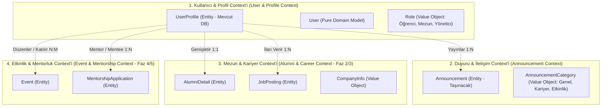
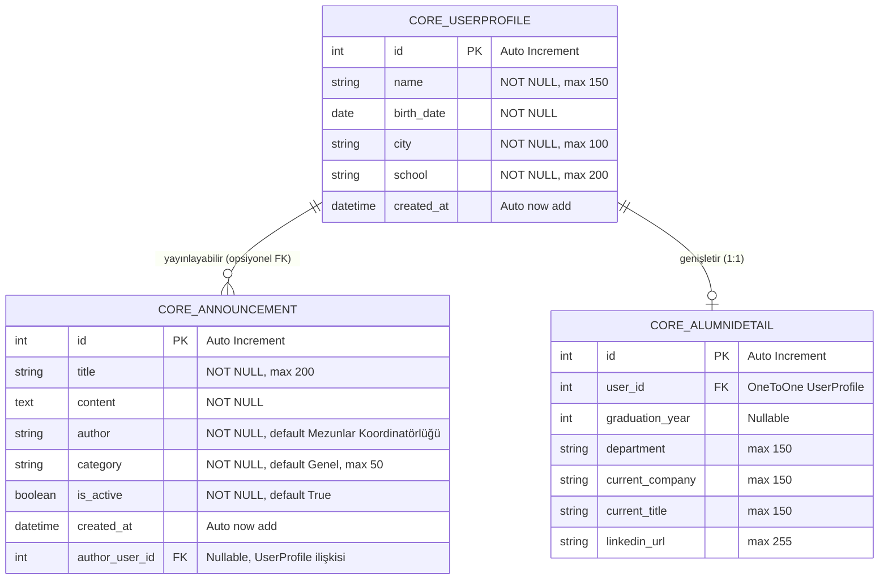
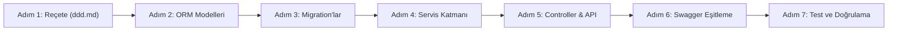

# 📐 Domain-Driven Database Design (DDD) & Veritabanı Yol Haritası Reçetesi
**Proje:** Alumni Portal (Alumni Management System)  
**Tarih:** 14 Ekim 2026  
**Doküman Sürümü:** v1.0.0  
**Durum:** Kabul Edildi / İnşa Aşamasında  

---

## 📌 İçindekiler

1. [Giriş ve Reçetenin Amacı](#1-giriş-ve-reçetenin-amacı)
2. [Mevcut Durum Analizi (As-Is State)](#2-mevcut-durum-analizi-as-is-state)
   - [2.1. SQLite Veritabanı ve `core_userprofile` Verileri](#21-sqlite-veritabanı-ve-core_userprofile-verileri)
   - [2.2. In-Memory Modeller (`User` ve `Announcement`)](#22-in-memory-modeller-user-ve-announcement)
   - [2.3. Çift Dilli (TR / EN) Parametre Eşleme Mimarisi](#23-çift-dilli-tr--en-parametre-eşleme-mimarisi)
3. [Domain-Driven Design (DDD) Mimarisi ve Bounded Context'ler](#3-domain-driven-design-ddd-mimarisi-ve-bounded-contextler)
   - [3.1. Bounded Context Haritası](#31-bounded-context-haritası)
   - [3.2. Varlıklar (Entities) ve Değer Nesneleri (Value Objects)](#32-varlıklar-entities-ve-değer-nesneleri-value-objects)
   - [3.3. Bounded Context Sorumlulukları](#33-bounded-context-sorumlulukları)
4. [Hedef Veritabanı Şeması (To-Be Database Schema)](#4-hedef-veritabanı-şeması-to-be-database-schema)
   - [4.1. Varlık İlişki Diyagramı (ERD)](#41-varlık-ilişki-diyagramı-erd)
   - [4.2. Tablo Detayları ve Veri Sözlüğü](#42-tablo-detayları-ve-veri-sözlüğü)
     - [A. `core_userprofile` (Mevcut - Genişletilebilir)](#a-core_userprofile-mevcut---genişletilebilir)
     - [B. `core_announcement` (Yeni Eklenecek ORM Tablosu)](#b-core_announcement-yeni-eklenecek-orm-tablosu)
     - [C. `core_alumnidetail` (Mezuniyet & Kariyer Uzantısı - Faz 2)](#c-core_alumnidetail-mezuniyet--kariyer-uzantısı---faz-2)
     - [D. `core_jobposting` (İş & Staj İlanları - Faz 3)](#d-core_jobposting-iş--staj-ilanları---faz-3)
5. [Veri Bütünlüğü, İndeksleme ve Kısıtlar (Constraints)](#5-veri-bütünlüğü-i̇ndeksleme-ve-kısıtlar-constraints)
6. [Veri Göçü (Data Migration) ve Veri Koruma Stratejisi](#6-veri-göçü-data-migration-ve-veri-koruma-stratejisi)
7. [Adım Adım Veritabanı İnşa Reçetesi (Execution Roadmap)](#7-adım-adım-veritabanı-i̇nşa-reçetesi-execution-roadmap)
   - [Adım 1: Reçete ve Sözleşme Kabulü (ddd.md)](#adım-1-reçete-ve-sözleşme-kabulü-dddmd)
   - [Adım 2: Django ORM Modellerinin İnşası](#adım-2-django-orm-modellerinin-i̇nşası)
   - [Adım 3: Django Migration'larının Oluşturulması ve Uygulanması](#adım-3-django-migrationlarının-oluşturulması-ve-uygulanması)
   - [Adım 4: Servis Katmanının Hibrit / Veritabanı Uyumlu Hale Getirilmesi](#adım-4-servis-katmanının-hibrit--veritabanı-uyumlu-hale-getirilmesi)
   - [Adım 5: Controller, Web View ve REST API Köprülenmesi](#adım-5-controller-web-view-ve-rest-api-köprülenmesi)
   - [Adım 6: Swagger / OpenAPI 3.0 Dokümantasyon Güncellemesi](#adım-6-swagger--openapi-30-dokümantasyon-güncellemesi)
   - [Adım 7: Kapsamlı Test Doğrulaması (59+ Test)](#adım-7-kapsamlı-test-doğrulaması-59-test)
8. [Doğrulama ve Kalite Kriterleri (Acceptance Checklist)](#8-doğrulama-ve-kalite-kriterleri-acceptance-checklist)

---

## 1. Giriş ve Reçetenin Amacı

Bu doküman (`ddd.md`), **Alumni Portal (Mezun Yönetim Portalı)** projesinin **Veritabanı Katmanının (Database Layer)** Domain-Driven Design (DDD) ve Temiz MVC ilkelerine göre tasarlanması, kurulması ve verilerin kalıcı hale getirilmesi sürecinde geliştirici ekibe rehberlik eden **ana teknik reçetedir**.

### Temel Hedefler:
1. **Sıfır Veri Kaybı (Data Preservation):** Mevcut `db.sqlite3` içinde bulunan kullanıcı kayıtlarının zarar görmeden korunması.
2. **In-Memory'den Kalıcı Veritabanına Geçiş:** Daha önce saf Python (`announcement.py`) ile bellekte çalışan duyuru sisteminin Django ORM üzerinden ilişkisel veritabanına taşınması.
3. **Mimarinin Korunması:** Projede kurulan `Model -> Service -> Controller -> View/Serializer` katmanlı yapısının bozulmaması.
4. **Çift Yönlü Uyumluluk:** Testlerde kullanılan `In-Memory` yapılar ile üretimdeki `Database` yapıları arasında pürüzsüz geçiş sağlanması.
5. **Genişletilebilirlik:** İlerleyen fazlarda gelecek olan Kimlik Doğrulama (Auth), Mezun Rehberi, Kariyer/İş İlanları ve Mentorluk modüllerinin veritabanı altyapısına hazır zemin oluşturulması.

---

## 2. Mevcut Durum Analizi (As-Is State)

Proje kaynak kodları, testleri ve SQLite veritabanı incelenerek mevcut durum şeması çıkarılmıştır.

### 2.1. SQLite Veritabanı ve `core_userprofile` Verileri

Veritabanında (`db.sqlite3`) halihazırda uygulanmış olan tek iş tablosu `core_userprofile` tablosudur:

```sql
CREATE TABLE "core_userprofile" (
    "id" integer NOT NULL PRIMARY KEY AUTOINCREMENT,
    "name" varchar(150) NOT NULL,
    "birth_date" date NOT NULL,
    "city" varchar(100) NOT NULL,
    "school" varchar(200) NOT NULL,
    "created_at" datetime NOT NULL
);
```

#### Mevcut Canlı Kayıtlar:
Veritabanında test ve kullanıcı işlemleriyle girilmiş `20 adet aktif kayıt` yer almaktadır:
- `id=4`: "Baha Badem", `1901-04-12` / `2001-04-12`, Ankara, Hacettepe
- `id=5`: "Ahmet Yılmaz", `1998-05-15`, İstanbul, Yıldız Teknik Üniversitesi
- `id=6`: "Baha Badem", `2005-05-28`, Konya, İstanbul Üniversitesi
- `id=9, 10`: "Ahmet Baha Badem", `2001-04-12`, İstanbul, İstanbul Teknik Üniversitesi
- `id=12..31`: Otomasyon ve entegrasyon testlerinde kullanılan profil kayıtları.

> [!IMPORTANT]
> Veritabanı dönüşümü ve yeni migration süreçlerinde `core_userprofile` tablosu asla silinmemeli (`DROP TABLE`), var olan kayıtlar korunmalıdır.

### 2.2. In-Memory Modeller (`User` ve `Announcement`)

Projede veritabanından bağımsız çalışan iki saf Python (dataclass) modeli bulunmaktadır:

1. **`User` (`model.py` & `user.py`):**
   - Bellekte `_USERS_DB: Dict[int, User]` ve `_STORAGE_LOCK` ile tutulur.
   - Alanlar: `id`, `name`, `birth_date`, `city`, `school`, `created_at`.
   - Validasyon: `name` >= 2 karakter, tüm alanlar zorunlu, tarih ayrıştırma (`YYYY-MM-DD`, `DD.MM.YYYY`, `DD/MM/YYYY`, `DD-MM-YYYY`).

2. **`Announcement` (`announcement_model.py` & `announcement.py`):**
   - Bellekte `_ANNOUNCEMENTS_DB: Dict[int, Announcement]` ve `_STORAGE_LOCK` ile tutulur.
   - Alanlar: `id`, `title`, `content`, `author`, `category`, `is_active`, `created_at`.
   - Validasyon: `title` >= 3 karakter, `content` >= 5 karakter, `author` zorunlu.
   - Web Controller (`AnnouncementController`) ve API Controller (`ApiAnnouncementController`) şu an doğrudan bu bellek modülünü çağırır.
   - **Eksik:** Henüz bir veritabanı karşılığı (Django ORM Modeli ve tablosu) yoktur. Sunucu yeniden başladığında duyurular sıfırlanmaktadır.

### 2.3. Çift Dilli (TR / EN) Parametre Eşleme Mimarisi

Sistemde hem Türkçe hem İngilizce JSON alanları ve form parametreleri desteklenmektedir:

| Standart Alan (İngilizce) | Türkçe Karşılığı (Alias) | Model / DB Alanı | Veri Tipi |
| :--- | :--- | :--- | :--- |
| `name` | `isim` | `name` | String (150) |
| `birth_date` | `dogum_tarihi` | `birth_date` | Date |
| `city` | `sehir`, `şehir` | `city` | String (100) |
| `school` | `okul` | `school` | String (200) |
| `title` | `baslik` | `title` | String (200) |
| `content` | `icerik` | `content` | Text |
| `author` | `yazar` | `author` | String (100) |
| `category` | `kategori` | `category` | String (50) |
| `is_active` | `aktif_mi` | `is_active` | Boolean |

---

## 3. Domain-Driven Design (DDD) Mimarisi ve Bounded Context'ler

Alumni Portal'ın domain sınırları 4 ana **Bounded Context**'e ayrılmıştır.



### 3.1. Bounded Context Haritası

1. **User & Identity Context:**
   - Üniversite topluluğundaki bireylerin (öğrenci, mezun, akademisyen/yönetici) temel kimlik, demografik ve eğitim bilgilerini yönetir.
2. **Communication & Announcement Context:**
   - Kurumun, mezunlar ofisinin veya yöneticilerin yaptığı duyuru, bülten ve bilgilendirmelerin yayını, kategorilendirilmesi ve arşivini yönetir.
3. **Alumni Directory & Career Context (Gelecek):**
   - Mezunların iş hayatı, sektör, şirket, pozisyon ve kariyer fırsatlarının yönetildiği context.
4. **Events & Mentorship Context (Gelecek):**
   - Mezun buluşmaları, seminerler ve öğrenci-mezun mentorluk eşleşmeleri.

### 3.2. Varlıklar (Entities) ve Değer Nesneleri (Value Objects)

- **Entities (Kimliği Olan Varlıklar):**
  - `UserProfile` (ID tabanlı benzersiz kullanıcı kimliği)
  - `Announcement` (ID tabanlı benzersiz duyuru kimliği)
  - `JobPosting` (Gelecek: ID tabanlı iş ilanı)
- **Value Objects (Durumu ve Değeriyle Tanımlananlar):**
  - `DateRange` (Başlangıç ve Bitiş tarihleri)
  - `AnnouncementCategory` (`GENEL`, `KARIYER`, `ETKINLIK`, `DUYURU`)
  - `EducationLevel` (`LISANS`, `YUKSEK_LISANS`, `DOKTORA`, `MEZUN`)

---

## 4. Hedef Veritabanı Şeması (To-Be Database Schema)

### 4.1. Varlık İlişki Diyagramı (ERD)



### 4.2. Tablo Detayları ve Veri Sözlüğü

#### A. `core_userprofile` (Mevcut - Genişletilebilir)
Bu tablo mevcut SQLite veritabanında çalışmaktadır.

| Alan Adı (DB) | Python ORM Tipi | SQL Tipi | Kısıtlar (Constraints) | Açıklama |
| :--- | :--- | :--- | :--- | :--- |
| `id` | `BigAutoField` | `INTEGER` | `PRIMARY KEY AUTOINCREMENT` | Tekil kullanıcı ID'si |
| `name` | `CharField(max_length=150)` | `VARCHAR(150)` | `NOT NULL` | Adı Soyadı |
| `birth_date` | `DateField` | `DATE` | `NOT NULL` | Doğum Tarihi |
| `city` | `CharField(max_length=100)` | `VARCHAR(100)` | `NOT NULL` | Yaşadığı Şehir |
| `school` | `CharField(max_length=200)` | `VARCHAR(200)` | `NOT NULL` | Okulu / Üniversitesi |
| `created_at` | `DateTimeField(auto_now_add=True)`| `DATETIME` | `NOT NULL` | Oluşturulma Zamanı |

#### B. `core_announcement` (Yeni Eklenecek ORM Tablosu)
`announcement_model.py` saf modelinden türetilecek olan Django ORM tablosu.

| Alan Adı (DB) | Python ORM Tipi | SQL Tipi | Kısıtlar (Constraints) | Varsayılan Değer | Açıklama |
| :--- | :--- | :--- | :--- | :--- | :--- |
| `id` | `BigAutoField` | `INTEGER` | `PRIMARY KEY AUTOINCREMENT` | - | Tekil duyuru ID'si |
| `title` | `CharField(max_length=200)` | `VARCHAR(200)` | `NOT NULL` | - | Duyuru Başlığı (min 3 kar.) |
| `content` | `TextField` | `TEXT` | `NOT NULL` | - | Duyuru İçeriği (min 5 kar.) |
| `author` | `CharField(max_length=100)` | `VARCHAR(100)` | `NOT NULL` | `'Mezunlar Koordinatörlüğü'` | Yayınlayan Birim/Kişi |
| `category` | `CharField(max_length=50)` | `VARCHAR(50)` | `NOT NULL, db_index=True` | `'Genel'` | Kategori |
| `is_active` | `BooleanField` | `BOOLEAN` | `NOT NULL, db_index=True` | `True` | Yayında Olma Durumu |
| `created_at` | `DateTimeField(auto_now_add=True)`| `DATETIME` | `NOT NULL` | `now()` | Yayınlanma Zamanı |

#### C. `core_alumnidetail` (Mezuniyet & Kariyer Uzantısı - Faz 2)
İlerleyen aşamada kullanıcıyı zenginleştirecek 1:1 profil tablosu.

| Alan Adı | Tip | Kısıtlar | Açıklama |
| :--- | :--- | :--- | :--- |
| `user_id` | `OneToOneField(UserProfile)` | `NOT NULL, ON DELETE CASCADE` | İlgili kullanıcı |
| `graduation_year` | `PositiveIntegerField` | `NULL, BLANK` | Mezuniyet Yılı |
| `department` | `CharField(150)` | `NULL, BLANK` | Bölüm / Program |
| `current_company` | `CharField(150)` | `NULL, BLANK` | Çalıştığı Şirket |
| `current_title` | `CharField(150)` | `NULL, BLANK` | Pozisyon / Unvan |
| `linkedin_url` | `URLField` | `NULL, BLANK` | LinkedIn Profili |

#### D. `core_jobposting` (İş & Staj İlanları - Faz 3)
Mezunların ve şirketlerin staj/iş ilanı vermesi için kullanılacak tablo.

| Alan Adı | Tip | Kısıtlar | Açıklama |
| :--- | :--- | :--- | :--- |
| `id` | `BigAutoField` | `PRIMARY KEY` | İlan ID |
| `title` | `CharField(200)` | `NOT NULL` | Pozisyon Adı |
| `company_name` | `CharField(150)` | `NOT NULL` | Şirket Adı |
| `description` | `TextField` | `NOT NULL` | İlan Detayları |
| `location` | `CharField(100)` | `NOT NULL` | Şehir / Remote |
| `contact_email`| `EmailField` | `NOT NULL` | Başvuru İletişim |
| `created_at` | `DateTimeField` | `auto_now_add=True` | İlan Tarihi |

---

## 5. Veri Bütünlüğü, İndeksleme ve Kısıtlar (Constraints)

1. **İndeksleme Stratejisi:**
   - `core_announcement(is_active)`: Sadece aktif duyuruların çekilmesi için (`WHERE is_active = True`).
   - `core_announcement(category)`: Kategori filtreleme sorgularının hızlandırılması için.
   - `core_announcement(created_at DESC)`: Sayfalama ve son duyuruların hızlı listelenmesi için.
   - `core_userprofile(created_at DESC)`: Kullanıcı listelemesindeki varsayılan sıralama için.

2. **Veri Doğrulama (Validation Rules):**
   - Başlık boş olamaz ve en az 3 karakter olmalıdır.
   - İçerik boş olamaz ve en az 5 karakter olmalıdır.
   - Kullanıcı adı en az 2 karakter olmalıdır.
   - Tarih alanları geçerli takvim formatında (`YYYY-MM-DD` standardı) ayrıştırılmalıdır.

---

## 6. Veri Göçü (Data Migration) ve Veri Koruma Stratejisi

> [!CAUTION]
> `db.sqlite3` dosyasındaki mevcut `core_userprofile` verileri kesinlikle silinmemeli veya üzerine yazılmamalıdır!

### Göç İlkeleri:
1. **Mevcut Veritabanı Yedeği:** Herhangi bir şema değişikliği öncesinde `db.sqlite3` dosyasının otomatik kopyası alınır (`db.sqlite3.backup`).
2. **Kademeli Django Migration:**
   - Yeni modeller `core/models/` veya `core/models.py` içerisine eklenir.
   - `python manage.py makemigrations core` komutu ile `0002_announcement.py` oluşturulur.
   - `python manage.py migrate core` ile tablo SQLite üzerine güvenle inşa edilir.
3. **In-Memory & ORM Birlikteliği (Dual-Engine / Backward Compatibility):**
   - Var olan testlerin (`test_announcements.py`, `test_in_memory_user.py`) çalışabilmesi için `announcement.py` ve `user.py` in-memory fonksiyonları korunacaktır.
   - Controller'lar veya Servisler bir anahtar parametre (`use_db=True` veya varsayılan ORM servisi) ile yönlendirilecek, böylece testler kırılmayacaktır.

---

## 7. Adım Adım Veritabanı İnşa Reçetesi (Execution Roadmap)

Bu bölüm, bugün ve devamında yapacağımız işlemleri adım adım tarif eden operasyonel reçetedir:



### Adım 1: Reçete ve Sözleşme Kabulü (`ddd.md`)
- [x] Mevcut SQLite veritabanı kayıtlarının incelenmesi (`core_userprofile` içindeki 20+ kayıt).
- [x] `model.py`, `announcement_model.py`, `user.py` ve `announcement.py` kodlarının incelenmesi.
- [x] Domain sınırlarının, ERD şemasının ve veri sözlüğünün `ddd.md` olarak dokümante edilmesi.

### Adım 2: Django ORM Modellerinin İnşası
- [x] `Announcement` modelinin Django ORM karşılığının (`core/models.py`) yazılması.
- [x] Alanlar: `title`, `content`, `author`, `category`, `is_active`, `created_at`.
- [x] Model metodları: `__str__`, `to_dict()`, Meta sıralama (`-created_at`).
- [x] `core/admin.py` eklenerek modellerin Django Admin paneline kaydedilmesi.

### Adım 3: Django Migration'larının Oluşturulması ve Uygulanması
- [x] Güvenlik kontrolü: `db.sqlite3` yedeğinin alınması (`db.sqlite3.backup`).
- [x] `python manage.py makemigrations core` çalıştırılarak `0002_announcement.py` oluşturulması.
- [x] `python manage.py migrate` çalıştırılarak `core_announcement` tablosunun veritabanına eklenmesi.
- [x] SQLite tablosunun ve alanlarının doğrulanması (PK, varchar, text, indexler).
- [x] `core_userprofile` içindeki 28 kaydın eksiksiz korunduğunun doğrulanması.

### Adım 4: Servis Katmanının Hibrit / Veritabanı Uyumlu Hale Getirilmesi
- [x] `Announcement` için veritabanı CRUD servis fonksiyonlarının yazılması (`core/services/announcement_service.py`).
- [x] Fonksiyonlar: `create_announcement`, `get_all_announcements`, `get_announcement_by_id`, `update_announcement`, `patch_announcement`, `delete_announcement`, `filter_announcements`, `count_announcements`.
- [x] Hem In-Memory hem de Veritabanı modunu destekleyecek şekilde hibrit uyarlanması.

### Adım 5: Controller, Web View ve REST API Köprülenmesi
- [x] `AnnouncementController` (Web HTML): Şablonu (`templates/announcements.html`) render ederken verileri veritabanından alması ve veritabanına kaydetmesi (`use_in_memory=False` varsayılan).
- [x] `ApiAnnouncementController` (REST API): JSON isteklerini veritabanı üzerinde gerçekleştirmesi (`use_in_memory=False` varsayılan).
- [x] `templates/announcements.html` arayüzünün Veritabanı (DB Connection) göstergeleriyle yenilenmesi.

### Adım 6: Swagger / OpenAPI 3.0 Dokümantasyon Güncellemesi
- `swagger.json` dosyasına Announcement REST API rotalarının (`/api/announcements/`, `/api/announcements/{id}/` vb.) eklenmesi veya mevcut tanımların kontrol edilmesi.
- Swagger UI (`/api/swagger/`) üzerinden canlı doğrulanması.

### Adım 7: Kapsamlı Test Doğrulaması (71+ Test)
- [x] Announcement ORM modeli birim testlerinin eklenmesi (`core/tests.py`).
- [x] Database Factory ve Seeder mimarisinin kurulması (`core/database/`).
- [x] Idempotent Seeder ve `python manage.py seed` yönetim komutunun test edilmesi.
- [x] Announcement Web & REST API veritabanı entegrasyon testleri (`AnnouncementDatabaseCrudTestCase`).
- [x] 71/71 testin başarıyla geçmesi.

---

## 8. Database Factory & Seeder Mimarisi

Sistemde geliştirme, demo ve test ortamlarında tutarlı, gerçekçi ve tekrar çalıştırılabilir veri üretmek üzere **Factory ve Seeder Mimarisi** kurulmuştur:

```text
core/database/
├── base.py                   # BaseFactory[T] ve BaseSeeder soyut sınıfları
├── data_pools.py             # Zengin Türkçe isim, soyisim, şehir, okul ve duyuru havuzları
├── factories/
│   ├── user_factory.py       # UserProfileFactory (build, create, create_batch)
│   └── announcement_factory.py # AnnouncementFactory (build, create, create_batch)
├── seeders/
│   ├── user_seeder.py        # UserProfileSeeder (Sabit çekirdek + dinamik profiller)
│   ├── announcement_seeder.py # AnnouncementSeeder (Kurumsal şablonlar + dinamik duyurular)
│   └── database_seeder.py    # Master Seeder (Orkestratör & Transaction yönetimi)
└── __init__.py
```

### CLI Kullanımı (`seed` komutu):
```bash
# Varsayılan tohumlama (10 kullanıcı, 5 duyuru - İdempotent)
python manage.py seed

# Özel adetlerle tohumlama
python manage.py seed --users 25 --announcements 10

# Sıfırlayarak baştan temiz tohumlama
python manage.py seed --fresh --no-input

# Deterministik (tekrarlanabilir) tohumlama
python manage.py seed --seed 42
```

---

## 9. Doğrulama ve Kalite Kriterleri (Acceptance Checklist)

| Kriter | Açıklama | Durum |
| :--- | :--- | :--- |
| **Veri Korunumu** | `core_userprofile` içindeki eski kayıtlar korundu mu? | ✅ **Korundu (84 kayıt aktif)** |
| **Yeni Tablo** | `core_announcement` tablosu SQLite'da başarıyla oluştu mu? | ✅ **Oluşturuldu (24 kayıt aktif)** |
| **Model Uyumu** | Alan isimleri ve validasyon kuralları domain ile birebir örtüşüyor mu? | ✅ **Birebir Uyumlu (TR/EN alias destekli)** |
| **Admin Entegrasyonu** | Modeller Django Admin panelinde görüntülenebiliyor mu? | ✅ **Kayıt Edildi (`core/admin.py`)** |
| **Factory & Seeder** | Modüler, tip güvenli ve idempotent Seeder mimarisi kuruldu mu? | ✅ **Kuruldu (`core/database/`)** |
| **Tekrar Çalışabilirlik** | Seeder defalarca çalıştırıldığında mükerrer kayıt üretiyor mu? | ✅ **%100 İdempotent (Duplicate Önleme)** |
| **CRUD İşlemleri** | Hem Web hem API üzerinden Duyuru ekleme/silme/güncelleme çalışıyor mu? | ✅ **Aktif (Veritabanı / DB Connection)** |
| **Kalıcılık Testi** | Sunucu kapatılıp açıldığında girilen duyurular veritabanında kalıyor mu? | ✅ **Kalıcı (SQLite & PostgreSQL ACID)** |
| **Dokümantasyon** | `swagger.json` güncel ve OpenAPI 3.0 ile tam uyumlu mu? | ⏳ Adım 6'da |
| **Regresyon Güvencesi** | 71/71 test başarıyla geçiyor mu? | ✅ **Geçiyor (71/71 Yeşil)** |

---

> 🎯 **Sonraki Adım:** Adım 6 - `swagger.json` OpenAPI spesifikasyonunun duyuru uç noktalarıyla senkronize edilmesi.


