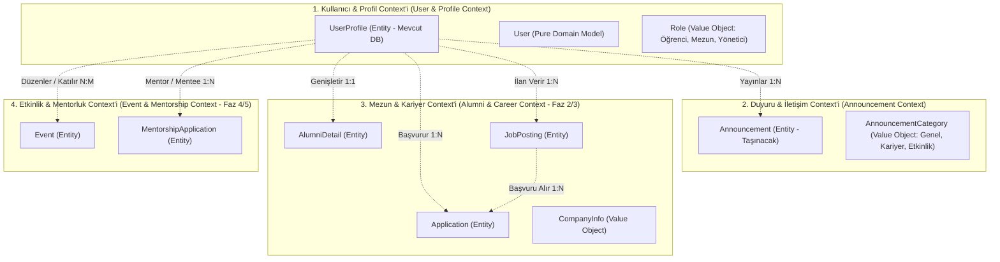
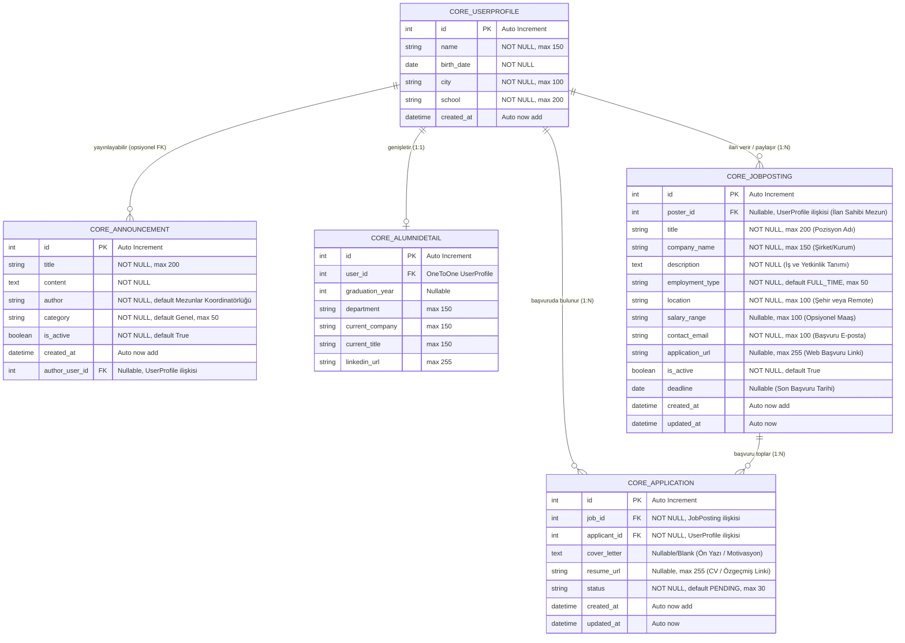
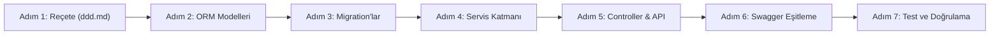

# 📐 Domain-Driven Database Design (DDD) & Veritabanı Yol Haritası Reçetesi
**Proje:** Alumni Portal (Alumni Management System)  
**Tarih:** 21 Ekim 2026  
**Doküman Sürümü:** v1.2.0 (Job Posting & Applications Tablo ve Rota Mimarisi Entegrasyonu)  
**Durum:** Kabul Edildi / İnşa Aşamasında  

---

## 📌 İçindekiler

1. [Giriş ve Reçetenin Amacı](#1-giriş-ve-reçetenin-amacı)
2. [Mevcut Durum Analizi (As-Is State)](#2-mevcut-durum-analizi-as-is-state)
   - [2.1. SQLite Veritabanı ve `core_userprofile` Verileri](#21-sqlite-veritabanı-ve-core_userprofile-verileri)
   - [2.2. In-Memory Modeller (`User` ve `Announcement`)](#22-in-memory-modeller-user-ve-announcement)
   - [2.3. Çift Dilli (TR / EN) Parametre Eşleme Mimarisi](#23-çift-dilli-tr--en-parametre-eşleme-mimarisi)
3. [Domain-Driven Design (DDD) Mimarisi ve Bounded Context'ler](#3-domain-driven-design-ddd-mimarisi-ve-bounded-contextler)
   - [3.1. Bounded Context Haritası](#31-bounded-context-haritası)
   - [3.2. Varlıklar (Entities) ve Değer Nesneleri (Value Objects)](#32-varlıklar-entities-ve-değer-nesneleri-value-objects)
   - [3.3. Bounded Context Sorumlulukları](#33-bounded-context-sorumlulukları)
4. [Hedef Veritabanı Şeması (To-Be Database Schema)](#4-hedef-veritabanı-şeması-to-be-database-schema)
   - [4.1. Varlık İlişki Diyagramı (ERD)](#41-varlık-ilişki-diyagramı-erd)
   - [4.2. Tablo Detayları ve Veri Sözlüğü](#42-tablo-detayları-ve-veri-sözlüğü)
     - [A. `core_userprofile` (Mevcut - Genişletilebilir)](#a-core_userprofile-mevcut---genişletilebilir)
     - [B. `core_announcement` (Yeni Eklenecek ORM Tablosu)](#b-core_announcement-yeni-eklenecek-orm-tablosu)
     - [C. `core_alumnidetail` (Mezuniyet & Kariyer Uzantısı - Faz 2)](#c-core_alumnidetail-mezuniyet--kariyer-uzantısı---faz-2)
     - [D. `core_jobposting` (İş & Staj İlanları Tablosu - Faz 3 / Kariyer Portalı)](#d-core_jobposting-iş--staj-i̇lanları-tablosu---faz-3--kariyer-portalı)
     - [E. `core_application` (İş & Staj Başvuruları Tablosu - Faz 3 / Kariyer Portalı)](#e-core_application-iş--staj-başvuruları-tablosu---faz-3--kariyer-portalı)
5. [Veri Bütünlüğü, İndeksleme ve Kısıtlar (Constraints)](#5-veri-bütünlüğü-i̇ndeksleme-ve-kısıtlar-constraints)
   - [5.1. İndeksleme Stratejisi](#51-i̇ndeksleme-stratejisi)
   - [5.2. Veri Doğrulama (Validation Rules)](#52-veri-doğrulama-validation-rules)
6. [Veri Göçü (Data Migration) ve Veri Koruma Stratejisi](#6-veri-göçü-data-migration-ve-veri-koruma-stratejisi)
7. [Adım Adım Veritabanı İnşa Reçetesi (Execution Roadmap)](#7-adım-adım-veritabanı-i̇nşa-reçetesi-execution-roadmap)
   - [Adım 1: Reçete ve Sözleşme Kabulü (ddd.md)](#adım-1-reçete-ve-sözleşme-kabulü-dddmd)
   - [Adım 2: Django ORM Modellerinin İnşası](#adım-2-django-orm-modellerinin-i̇nşası)
   - [Adım 3: Django Migration'larının Oluşturulması ve Uygulanması](#adım-3-django-migrationlarının-oluşturulması-ve-uygulanması)
   - [Adım 4: Servis Katmanının Hibrit / Veritabanı Uyumlu Hale Getirilmesi](#adım-4-servis-katmanının-hibrit--veritabanı-uyumlu-hale-getirilmesi)
   - [Adım 5: Controller, Web View ve REST API Köprülenmesi](#adım-5-controller-web-view-ve-rest-api-köprülenmesi)
   - [Adım 6: Swagger / OpenAPI 3.0 Dokümantasyon Güncellemesi](#adım-6-swagger--openapi-30-dokümantasyon-güncellemesi)
   - [Adım 7: Kapsamlı Test Doğrulaması (71+ Test)](#adım-7-kapsamlı-test-doğrulaması-71-test)
   - [Adım 8: Kariyer & İş İlanları Tablosunun İnşası (JobPosting)](#adım-8-kariyer--i̇ş-i̇lanları-tablosunun-i̇nşası-jobposting)
   - [Adım 9: Başvuru Yönetimi Tablosu & Doğrudan/İç İçe Rotaların İnşası (Application)](#adım-9-başvuru-yönetimi-tablosu--doğrudaniç-i̇çe-rotaların-i̇nşası-application)
8. [Database Factory & Seeder Mimarisi](#8-database-factory--seeder-mimarisi)
9. [Doğrulama ve Kalite Kriterleri (Acceptance Checklist)](#9-doğrulama-ve-kalite-kriterleri-acceptance-checklist)

---

## 1. Giriş ve Reçetenin Amacı

Bu doküman (`ddd.md`), **Alumni Portal (Mezun Yönetim Portalı)** projesinin **Veritabanı Katmanının (Database Layer)** Domain-Driven Design (DDD) ve Temiz MVC ilkelerine göre tasarlanması, kurulması ve verilerin kalıcı hale getirilmesi sürecinde geliştirici ekibe rehberlik eden **ana teknik reçetedir**.

### Temel Hedefler:
1. **Sıfır Veri Kaybı (Data Preservation):** Mevcut `db.sqlite3` içinde bulunan kullanıcı kayıtlarının zarar görmeden korunması.
2. **In-Memory'den Kalıcı Veritabanına Geçiş:** Daha önce saf Python (`announcement.py`) ile bellekte çalışan duyuru sisteminin Django ORM üzerinden ilişkisel veritabanına taşınması.
3. **Mimarinin Korunması:** Projede kurulan `Model -> Service -> Controller -> View/Serializer` katmanlı yapısının bozulmaması.
4. **Çift Yönlü Uyumluluk:** Testlerde kullanılan `In-Memory` yapılar ile üretimdeki `Database` yapıları arasında pürüzsüz geçiş sağlanması.
5. **Genişletilebilirlik:** İlerleyen fazlarda gelecek olan Kimlik Doğrulama (Auth), Mezun Rehberi, Kariyer/İş İlanları ve Mentorluk modüllerinin veritabanı altyapısına hazır zemin oluşturulması.

---

## 2. Mevcut Durum Analizi (As-Is State)

Proje kaynak kodları, testleri ve SQLite veritabanı incelenerek mevcut durum şeması çıkarılmıştır.

### 2.1. SQLite Veritabanı ve `core_userprofile` Verileri

Veritabanında (`db.sqlite3`) halihazırda uygulanmış olan tek iş tablosu `core_userprofile` tablosudur:

```sql
CREATE TABLE "core_userprofile" (
    "id" integer NOT NULL PRIMARY KEY AUTOINCREMENT,
    "name" varchar(150) NOT NULL,
    "birth_date" date NOT NULL,
    "city" varchar(100) NOT NULL,
    "school" varchar(200) NOT NULL,
    "created_at" datetime NOT NULL
);
```

#### Mevcut Canlı Kayıtlar:
Veritabanında test ve kullanıcı işlemleriyle girilmiş `20 adet aktif kayıt` yer almaktadır:
- `id=4`: "Baha Badem", `1901-04-12` / `2001-04-12`, Ankara, Hacettepe
- `id=5`: "Ahmet Yılmaz", `1998-05-15`, İstanbul, Yıldız Teknik Üniversitesi
- `id=6`: "Baha Badem", `2005-05-28`, Konya, İstanbul Üniversitesi
- `id=9, 10`: "Ahmet Baha Badem", `2001-04-12`, İstanbul, İstanbul Teknik Üniversitesi
- `id=12..31`: Otomasyon ve entegrasyon testlerinde kullanılan profil kayıtları.

> [!IMPORTANT]
> Veritabanı dönüşümü ve yeni migration süreçlerinde `core_userprofile` tablosu asla silinmemeli (`DROP TABLE`), var olan kayıtlar korunmalıdır.

### 2.2. In-Memory Modeller (`User` ve `Announcement`)

Projede veritabanından bağımsız çalışan iki saf Python (dataclass) modeli bulunmaktadır:

1. **`User` (`model.py` & `user.py`):**
   - Bellekte `_USERS_DB: Dict[int, User]` ve `_STORAGE_LOCK` ile tutulur.
   - Alanlar: `id`, `name`, `birth_date`, `city`, `school`, `created_at`.
   - Validasyon: `name` >= 2 karakter, tüm alanlar zorunlu, tarih ayrıştırma (`YYYY-MM-DD`, `DD.MM.YYYY`, `DD/MM/YYYY`, `DD-MM-YYYY`).

2. **`Announcement` (`announcement_model.py` & `announcement.py`):**
   - Bellekte `_ANNOUNCEMENTS_DB: Dict[int, Announcement]` ve `_STORAGE_LOCK` ile tutulur.
   - Alanlar: `id`, `title`, `content`, `author`, `category`, `is_active`, `created_at`.
   - Validasyon: `title` >= 3 karakter, `content` >= 5 karakter, `author` zorunlu.
   - Web Controller (`AnnouncementController`) ve API Controller (`ApiAnnouncementController`) şu an doğrudan bu bellek modülünü çağırır.
   - **Eksik:** Henüz bir veritabanı karşılığı (Django ORM Modeli ve tablosu) yoktur. Sunucu yeniden başladığında duyurular sıfırlanmaktadır.

### 2.3. Çift Dilli (TR / EN) Parametre Eşleme Mimarisi

Sistemde hem Türkçe hem İngilizce JSON alanları ve form parametreleri desteklenmektedir:

| Standart Alan (İngilizce) | Türkçe Karşılığı (Alias) | Model / DB Alanı | Veri Tipi | İlgili Tablo / Context |
| :--- | :--- | :--- | :--- | :--- |
| `name` | `isim` | `name` | String (150) | `core_userprofile` |
| `birth_date` | `dogum_tarihi` | `birth_date` | Date | `core_userprofile` |
| `city` | `sehir`, `şehir` | `city` | String (100) | `core_userprofile` |
| `school` | `okul` | `school` | String (200) | `core_userprofile` |
| `title` | `baslik` | `title` | String (200) | `core_announcement` |
| `content` | `icerik` | `content` | Text | `core_announcement` |
| `author` | `yazar` | `author` | String (100) | `core_announcement` |
| `category` | `kategori` | `category` | String (50) | `core_announcement` |
| `is_active` | `aktif_mi`, `yayinda_mi` | `is_active` | Boolean | `core_announcement`, `core_jobposting` |
| `job_title` / `title` | `is_basligi`, `baslik` | `title` | String (200) | `core_jobposting` |
| `company_name` | `sirket`, `sirket_adi`, `kurum` | `company_name` | String (150) | `core_jobposting` |
| `description` | `aciklama`, `is_tanimi`, `icerik` | `description` | Text | `core_jobposting` |
| `employment_type` | `is_tipi`, `calisma_sekli`, `istihdam_turu` | `employment_type` | String (50) | `core_jobposting` |
| `location` | `konum`, `lokasyon`, `sehir` | `location` | String (100) | `core_jobposting` |
| `salary_range` | `maas_araligi`, `maas` | `salary_range` | String (100) | `core_jobposting` |
| `contact_email` | `iletisim_eposta`, `email`, `eposta` | `contact_email` | Email / String (100) | `core_jobposting` |
| `application_url` | `basvuru_linki`, `basvuru_adresi`, `url` | `application_url` | URL / String (255) | `core_jobposting` |
| `deadline` | `son_basvuru_tarihi`, `bitis_tarihi` | `deadline` | Date | `core_jobposting` |
| `poster_id` | `ilan_sahibi_id`, `kullanici_id` | `poster_id` | Integer (FK) | `core_jobposting` |
| `job_id` | `ilan_id`, `is_ilani_id` | `job_id` | Integer (FK) | `core_application` |
| `applicant_id` | `basvuran_id`, `mezun_id` | `applicant_id` | Integer (FK) | `core_application` |
| `cover_letter` | `on_yazi`, `motivasyon_mektubu` | `cover_letter` | Text | `core_application` |
| `resume_url` | `cv_linki`, `ozgecmis_linki` | `resume_url` | URL / String (255) | `core_application` |
| `status` | `durum`, `basvuru_durumu` | `status` | String (30) | `core_application` |

---

## 3. Domain-Driven Design (DDD) Mimarisi ve Bounded Context'ler

Alumni Portal'ın domain sınırları 4 ana **Bounded Context**'e ayrılmıştır.



### 3.1. Bounded Context Haritası

1. **User & Identity Context:**
   - Üniversite topluluğundaki bireylerin (öğrenci, mezun, akademisyen/yönetici) temel kimlik, demografik ve eğitim bilgilerini yönetir.
2. **Communication & Announcement Context:**
   - Kurumun, mezunlar ofisinin veya yöneticilerin yaptığı duyuru, bülten ve bilgilendirmelerin yayını, kategorilendirilmesi ve arşivini yönetir.
3. **Alumni Directory & Career Context (Mezun Rehberi & Kariyer Context'i):**
   - Mezunların profesyonel iş hayatı, sektör, şirket, pozisyon ve staj/iş fırsatlarının (`JobPosting`) ve bu ilanlara yapılan başvuruların (`Application`) yönetildiği context. Mezunlar ve yetkililer staj/iş ilanları paylaşabilir; aday mezunlar ilanlara başvurabilir (`ApplicationStatus` yaşam döngüsü).
4. **Events & Mentorship Context (Gelecek):**
   - Mezun buluşmaları, seminerler ve öğrenci-mezun mentorluk eşleşmeleri.

### 3.2. Varlıklar (Entities) ve Değer Nesneleri (Value Objects)

- **Entities (Kimliği Olan Varlıklar):**
  - `UserProfile` (ID tabanlı benzersiz kullanıcı kimliği)
  - `Announcement` (ID tabanlı benzersiz duyuru kimliği)
  - `JobPosting` (ID tabanlı iş ve staj ilanı varlığı; kariyer fırsatları ve başvuru takibi)
  - `Application` (ID tabanlı iş/staj başvurusu varlığı; ilan ile başvuran mezun arasındaki ilişkiyi ve başvuru sürecini yönetir)
  - `AlumniDetail` (Kullanıcı profilini zenginleştiren 1:1 kariyer ve mezuniyet uzantısı)
- **Value Objects (Durumu ve Değeriyle Tanımlananlar):**
  - `ApplicationStatus` (`PENDING`: Beklemede, `IN_REVIEW`: İncelemede, `ACCEPTED`: Kabul Edildi, `REJECTED`: Reddedildi, `WITHDRAWN`: Geri Çekildi)
  - `EmploymentType` (`FULL_TIME`: Tam Zamanlı, `PART_TIME`: Yarı Zamanlı, `INTERNSHIP`: Stajyer, `REMOTE`: Uzaktan, `HYBRID`: Hibrit, `CONTRACT`: Sözleşmeli)
  - `JobPostingStatus` (`DRAFT`: Taslak, `ACTIVE`: Yayında, `CLOSED`: Kapanmış, `EXPIRED`: Süresi Dolmuş)
  - `SalaryRange` (Opsiyonel maaş skalası ve para birimi)
  - `ApplicationChannel` (Doğrudan e-posta veya harici web başvuru URL'i)
  - `DateRange` (Başlangıç ve Bitiş tarihleri)
  - `AnnouncementCategory` (`GENEL`, `KARIYER`, `ETKINLIK`, `DUYURU`)
  - `EducationLevel` (`LISANS`, `YUKSEK_LISANS`, `DOKTORA`, `MEZUN`)

---

## 4. Hedef Veritabanı Şeması (To-Be Database Schema)

### 4.1. Varlık İlişki Diyagramı (ERD)



### 4.2. Tablo Detayları ve Veri Sözlüğü

#### A. `core_userprofile` (Mevcut - Genişletilebilir)
Bu tablo mevcut SQLite veritabanında çalışmaktadır.

| Alan Adı (DB) | Python ORM Tipi | SQL Tipi | Kısıtlar (Constraints) | Açıklama |
| :--- | :--- | :--- | :--- | :--- |
| `id` | `BigAutoField` | `INTEGER` | `PRIMARY KEY AUTOINCREMENT` | Tekil kullanıcı ID'si |
| `name` | `CharField(max_length=150)` | `VARCHAR(150)` | `NOT NULL` | Adı Soyadı |
| `birth_date` | `DateField` | `DATE` | `NOT NULL` | Doğum Tarihi |
| `city` | `CharField(max_length=100)` | `VARCHAR(100)` | `NOT NULL` | Yaşadığı Şehir |
| `school` | `CharField(max_length=200)` | `VARCHAR(200)` | `NOT NULL` | Okulu / Üniversitesi |
| `created_at` | `DateTimeField(auto_now_add=True)`| `DATETIME` | `NOT NULL` | Oluşturulma Zamanı |

#### B. `core_announcement` (Yeni Eklenecek ORM Tablosu)
`announcement_model.py` saf modelinden türetilecek olan Django ORM tablosu.

| Alan Adı (DB) | Python ORM Tipi | SQL Tipi | Kısıtlar (Constraints) | Varsayılan Değer | Açıklama |
| :--- | :--- | :--- | :--- | :--- | :--- |
| `id` | `BigAutoField` | `INTEGER` | `PRIMARY KEY AUTOINCREMENT` | - | Tekil duyuru ID'si |
| `title` | `CharField(max_length=200)` | `VARCHAR(200)` | `NOT NULL` | - | Duyuru Başlığı (min 3 kar.) |
| `content` | `TextField` | `TEXT` | `NOT NULL` | - | Duyuru İçeriği (min 5 kar.) |
| `author` | `CharField(max_length=100)` | `VARCHAR(100)` | `NOT NULL` | `'Mezunlar Koordinatörlüğü'` | Yayınlayan Birim/Kişi |
| `category` | `CharField(max_length=50)` | `VARCHAR(50)` | `NOT NULL, db_index=True` | `'Genel'` | Kategori |
| `is_active` | `BooleanField` | `BOOLEAN` | `NOT NULL, db_index=True` | `True` | Yayında Olma Durumu |
| `created_at` | `DateTimeField(auto_now_add=True)`| `DATETIME` | `NOT NULL` | `now()` | Yayınlanma Zamanı |

#### C. `core_alumnidetail` (Mezuniyet & Kariyer Uzantısı - Faz 2)
İlerleyen aşamada kullanıcıyı zenginleştirecek 1:1 profil tablosu.

| Alan Adı | Tip | Kısıtlar | Açıklama |
| :--- | :--- | :--- | :--- |
| `user_id` | `OneToOneField(UserProfile)` | `NOT NULL, ON DELETE CASCADE` | İlgili kullanıcı |
| `graduation_year` | `PositiveIntegerField` | `NULL, BLANK` | Mezuniyet Yılı |
| `department` | `CharField(150)` | `NULL, BLANK` | Bölüm / Program |
| `current_company` | `CharField(150)` | `NULL, BLANK` | Çalıştığı Şirket |
| `current_title` | `CharField(150)` | `NULL, BLANK` | Pozisyon / Unvan |
| `linkedin_url` | `URLField` | `NULL, BLANK` | LinkedIn Profili |

#### D. `core_jobposting` (İş & Staj İlanları Tablosu - Faz 3 / Kariyer Portalı)

Mezunların, partner kurumların veya kariyer ofisinin açtığı iş, staj ve proje bazlı çalışma fırsatlarını ilişkisel veritabanında saklayan, Domain-Driven Design prensiplerine uygun çekirdek modeldir. `core_userprofile` ile opsiyonel Foreign Key ilişkisine sahiptir; böylece ilanı yayınlayan mezun/yetkili ile ilan arasında doğrudan bağ kurulur.

##### Veri Sözlüğü (Data Dictionary)

| Alan Adı (DB) | Python ORM Tipi | SQL Tipi | Kısıtlar (Constraints) | Varsayılan Değer | Açıklama |
| :--- | :--- | :--- | :--- | :--- | :--- |
| `id` | `BigAutoField` | `INTEGER` | `PRIMARY KEY AUTOINCREMENT` | - | Tekil ilan ID'si |
| `poster_id` | `ForeignKey(UserProfile)` | `INTEGER` | `NULL, BLANK, ON DELETE SET_NULL, db_index=True` | `NULL` | İlanı açan mezun/kullanıcı (Opsiyonel FK) |
| `title` | `CharField(max_length=200)` | `VARCHAR(200)` | `NOT NULL, db_index=True` | - | Pozisyon / Rol başlığı (min 3 kar.) |
| `company_name` | `CharField(max_length=150)` | `VARCHAR(150)` | `NOT NULL, db_index=True` | - | Şirket / Kurum Adı (min 2 kar.) |
| `description` | `TextField` | `TEXT` | `NOT NULL` | - | İlan detayları ve gereksinimler (min 10 kar.) |
| `employment_type` | `CharField(max_length=50)` | `VARCHAR(50)` | `NOT NULL, db_index=True` | `'FULL_TIME'` | Çalışma şekli (Full-Time, Staj, Remote vs.) |
| `location` | `CharField(max_length=100)` | `VARCHAR(100)` | `NOT NULL, db_index=True` | `'İstanbul / Hibrit'` | Lokasyon (Şehir veya Remote/Hibrit) |
| `salary_range` | `CharField(max_length=100)` | `VARCHAR(100)` | `NULL, BLANK` | `NULL` | Ücret skalası (Opsiyonel) |
| `contact_email` | `EmailField(max_length=100)` | `VARCHAR(100)` | `NOT NULL` | - | Başvuru e-posta adresi |
| `application_url` | `URLField(max_length=255)` | `VARCHAR(255)` | `NULL, BLANK` | `NULL` | Harici başvuru formu bağlantısı |
| `is_active` | `BooleanField` | `BOOLEAN` | `NOT NULL, db_index=True` | `True` | Yayında olma durumu |
| `deadline` | `DateField` | `DATE` | `NULL, BLANK, db_index=True` | `NULL` | Son başvuru tarihi |
| `created_at` | `DateTimeField(auto_now_add=True)`| `DATETIME` | `NOT NULL` | `now()` | İlan oluşturulma zamanı |
| `updated_at` | `DateTimeField(auto_now=True)` | `DATETIME` | `NOT NULL` | `now()` | Son güncelleme zamanı |

##### Hedef SQL DDL Şeması (`SQLite` & `PostgreSQL` Uyumlu)

```sql
CREATE TABLE "core_jobposting" (
    "id" integer NOT NULL PRIMARY KEY AUTOINCREMENT,
    "poster_id" integer NULL REFERENCES "core_userprofile" ("id") DEFERRABLE INITIALLY DEFERRED,
    "title" varchar(200) NOT NULL,
    "company_name" varchar(150) NOT NULL,
    "description" text NOT NULL,
    "employment_type" varchar(50) NOT NULL,
    "location" varchar(100) NOT NULL,
    "salary_range" varchar(100) NULL,
    "contact_email" varchar(100) NOT NULL,
    "application_url" varchar(255) NULL,
    "is_active" bool NOT NULL,
    "deadline" date NULL,
    "created_at" datetime NOT NULL,
    "updated_at" datetime NOT NULL
);

-- Performans ve Filtreleme İndeksleri
CREATE INDEX "core_jobposting_poster_id_idx" ON "core_jobposting" ("poster_id");
CREATE INDEX "core_jobposting_is_active_created_at_idx" ON "core_jobposting" ("is_active", "created_at" DESC);
CREATE INDEX "core_jobposting_emp_type_active_idx" ON "core_jobposting" ("employment_type", "is_active");
CREATE INDEX "core_jobposting_location_idx" ON "core_jobposting" ("location");
CREATE INDEX "core_jobposting_deadline_idx" ON "core_jobposting" ("deadline");
```

##### Hedef Django ORM Model Tasarımı (`core/models.py`)

```python
from django.db import models
from django.utils import timezone


class JobPosting(models.Model):
    """
    Alumni Portal İş ve Staj İlanı Modeli (Django ORM).
    Mezunlar veya yöneticiler tarafından paylaşılan kariyer fırsatlarını yönetir.
    Çift dilli JSON sözlüğü (TR/EN) ve zengin filtreleme yeteneklerini destekler.
    """
    EMPLOYMENT_TYPES = [
        ('FULL_TIME', 'Tam Zamanlı'),
        ('PART_TIME', 'Yarı Zamanlı'),
        ('INTERNSHIP', 'Stajyer'),
        ('REMOTE', 'Uzaktan / Remote'),
        ('HYBRID', 'Hibrit'),
        ('CONTRACT', 'Sözleşmeli / Proje Bazlı'),
    ]

    poster = models.ForeignKey(
        'UserProfile',
        on_delete=models.SET_NULL,
        null=True,
        blank=True,
        related_name='job_postings',
        verbose_name="İlanı Veren Mezun/Yetkili"
    )
    title = models.CharField(max_length=200, db_index=True, verbose_name="Pozisyon Başlığı")
    company_name = models.CharField(max_length=150, db_index=True, verbose_name="Şirket / Kurum Adı")
    description = models.TextField(verbose_name="İş Tanımı ve Aranan Nitelikler")
    employment_type = models.CharField(
        max_length=50,
        choices=EMPLOYMENT_TYPES,
        default='FULL_TIME',
        db_index=True,
        verbose_name="Çalışma Şekli"
    )
    location = models.CharField(max_length=100, db_index=True, verbose_name="Lokasyon / Şehir")
    salary_range = models.CharField(max_length=100, blank=True, null=True, verbose_name="Maaş Skalası")
    contact_email = models.EmailField(max_length=100, verbose_name="İletişim / Başvuru E-postası")
    application_url = models.URLField(max_length=255, blank=True, null=True, verbose_name="Harici Başvuru URL")
    is_active = models.BooleanField(default=True, db_index=True, verbose_name="Yayında mı?")
    deadline = models.DateField(blank=True, null=True, db_index=True, verbose_name="Son Başvuru Tarihi")
    created_at = models.DateTimeField(auto_now_add=True, verbose_name="Oluşturulma Tarihi")
    updated_at = models.DateTimeField(auto_now=True, verbose_name="Son Güncellenme Tarihi")

    class Meta:
        ordering = ['-created_at']
        verbose_name = "İş / Staj İlanı"
        verbose_name_plural = "İş / Staj İlanları"
        indexes = [
            models.Index(fields=['is_active', '-created_at'], name='core_job_active_created_idx'),
            models.Index(fields=['employment_type', 'is_active'], name='core_job_type_active_idx'),
            models.Index(fields=['location', 'is_active'], name='core_job_loc_active_idx'),
        ]

    def __str__(self):
        return f"{self.title} @ {self.company_name} ({self.get_employment_type_display()})"

    @property
    def is_expired(self) -> bool:
        """İlanın son başvuru tarihinin geçip geçmediğini kontrol eder."""
        if self.deadline:
            return self.deadline < timezone.now().date()
        return False

    def to_dict(self):
        """
        Model örneğini hem Türkçe hem İngilizce alias destekli JSON sözlüğüne dönüştürür.
        Clean MVC / API standartları ile tam uyumludur.
        """
        deadline_str = self.deadline.strftime('%Y-%m-%d') if self.deadline else None
        created_str = self.created_at.strftime('%Y-%m-%d %H:%M:%S') if self.created_at else None
        updated_str = self.updated_at.strftime('%Y-%m-%d %H:%M:%S') if self.updated_at else None

        return {
            "id": self.id,
            "poster_id": self.poster_id,
            "ilan_sahibi_id": self.poster_id,
            "title": self.title,
            "baslik": self.title,
            "is_basligi": self.title,
            "company_name": self.company_name,
            "sirket": self.company_name,
            "sirket_adi": self.company_name,
            "description": self.description,
            "aciklama": self.description,
            "is_tanimi": self.description,
            "employment_type": self.employment_type,
            "employment_type_display": self.get_employment_type_display(),
            "is_tipi": self.employment_type,
            "calisma_sekli": self.get_employment_type_display(),
            "location": self.location,
            "konum": self.location,
            "sehir": self.location,
            "salary_range": self.salary_range,
            "maas_araligi": self.salary_range,
            "contact_email": self.contact_email,
            "iletisim_eposta": self.contact_email,
            "email": self.contact_email,
            "application_url": self.application_url,
            "basvuru_linki": self.application_url,
            "is_active": self.is_active,
            "aktif_mi": self.is_active,
            "yayinda_mi": self.is_active,
            "deadline": deadline_str,
            "son_basvuru_tarihi": deadline_str,
            "is_expired": self.is_expired,
            "suresi_doldu_mu": self.is_expired,
            "created_at": created_str,
            "olusturulma_tarihi": created_str,
            "updated_at": updated_str,
            "guncellenme_tarihi": updated_str,
        }
```

#### E. `core_application` (İş & Staj Başvuruları Tablosu - Faz 3 / Kariyer Portalı)

Mezun ve öğrencilerin yayınlanan iş veya staj ilanlarına yaptıkları başvuruları saklayan, başvuru durumunu ve adayın motivasyon/özgeçmiş bilgilerini yöneten ilişkisel modeldir. `core_jobposting` ve `core_userprofile` tablolarına Foreign Key ile bağlıdır. Bir adayın aynı ilana mükerrer başvuru yapması veritabanı kısıtı (`unique_together = ('job', 'applicant')`) ile engellenir.

##### Veri Sözlüğü (Data Dictionary)

| Alan Adı (DB) | Python ORM Tipi | SQL Tipi | Kısıtlar (Constraints) | Varsayılan Değer | Açıklama |
| :--- | :--- | :--- | :--- | :--- | :--- |
| `id` | `BigAutoField` | `INTEGER` | `PRIMARY KEY AUTOINCREMENT` | - | Tekil başvuru ID'si |
| `job_id` | `ForeignKey(JobPosting)` | `INTEGER` | `NOT NULL, ON DELETE CASCADE, db_index=True` | - | Başvurulan iş ilanı |
| `applicant_id` | `ForeignKey(UserProfile)` | `INTEGER` | `NOT NULL, ON DELETE CASCADE, db_index=True` | - | Başvuru yapan mezun/öğrenci |
| `cover_letter` | `TextField` | `TEXT` | `BLANK` | `""` | Ön yazı / Motivasyon mektubu |
| `resume_url` | `URLField(max_length=255)` | `VARCHAR(255)` | `NULL, BLANK` | `NULL` | Özgeçmiş / CV bağlantı linki |
| `status` | `CharField(max_length=30)` | `VARCHAR(30)` | `NOT NULL, db_index=True` | `'PENDING'` | Başvuru durumu (Beklemede, Kabul vs.) |
| `created_at` | `DateTimeField(auto_now_add=True)`| `DATETIME` | `NOT NULL` | `now()` | Başvuru tarihi |
| `updated_at` | `DateTimeField(auto_now=True)` | `DATETIME` | `NOT NULL` | `now()` | Son işlem / durum güncelleme tarihi |

##### Hedef SQL DDL Şeması (`SQLite` & `PostgreSQL` Uyumlu)

```sql
CREATE TABLE "core_application" (
    "id" integer NOT NULL PRIMARY KEY AUTOINCREMENT,
    "job_id" integer NOT NULL REFERENCES "core_jobposting" ("id") DEFERRABLE INITIALLY DEFERRED,
    "applicant_id" integer NOT NULL REFERENCES "core_userprofile" ("id") DEFERRABLE INITIALLY DEFERRED,
    "cover_letter" text NOT NULL,
    "resume_url" varchar(255) NULL,
    "status" varchar(30) NOT NULL,
    "created_at" datetime NOT NULL,
    "updated_at" datetime NOT NULL,
    CONSTRAINT "core_application_job_applicant_uniq" UNIQUE ("job_id", "applicant_id")
);

-- Performans ve İlişkisel Filtreleme İndeksleri
CREATE INDEX "core_application_job_id_idx" ON "core_application" ("job_id");
CREATE INDEX "core_application_applicant_id_idx" ON "core_application" ("applicant_id");
CREATE INDEX "core_application_status_created_idx" ON "core_application" ("status", "created_at" DESC);
CREATE INDEX "core_application_job_status_idx" ON "core_application" ("job_id", "status");
CREATE INDEX "core_application_user_status_idx" ON "core_application" ("applicant_id", "status");
```

##### Hedef Django ORM Model Tasarımı (`core/models.py`)

```python
class Application(models.Model):
    STATUS_CHOICES = [
        ('PENDING', 'Beklemede'),
        ('IN_REVIEW', 'İncelemede'),
        ('ACCEPTED', 'Kabul Edildi'),
        ('REJECTED', 'Reddedildi'),
        ('WITHDRAWN', 'Geri Çekildi'),
    ]

    job = models.ForeignKey(
        'JobPosting',
        on_delete=models.CASCADE,
        related_name='applications',
        verbose_name="İş İlanı"
    )
    applicant = models.ForeignKey(
        'UserProfile',
        on_delete=models.CASCADE,
        related_name='applications',
        verbose_name="Başvuran Mezun/Öğrenci"
    )
    cover_letter = models.TextField(blank=True, default="", verbose_name="Ön Yazı / Motivasyon")
    resume_url = models.URLField(max_length=255, blank=True, null=True, verbose_name="Özgeçmiş / CV Linki")
    status = models.CharField(
        max_length=30,
        choices=STATUS_CHOICES,
        default='PENDING',
        db_index=True,
        verbose_name="Başvuru Durumu"
    )
    created_at = models.DateTimeField(auto_now_add=True, verbose_name="Başvuru Tarihi")
    updated_at = models.DateTimeField(auto_now=True, verbose_name="Güncellenme Tarihi")

    class Meta:
        ordering = ['-created_at']
        verbose_name = "İş / Staj Başvurusu"
        verbose_name_plural = "İş / Staj Başvuruları"
        unique_together = [('job', 'applicant')]
        indexes = [
            models.Index(fields=['status', '-created_at'], name='core_app_status_created_idx'),
            models.Index(fields=['job', 'status'], name='core_app_job_status_idx'),
            models.Index(fields=['applicant', 'status'], name='core_app_user_status_idx'),
        ]

    def __str__(self):
        return f"{self.applicant.name} -> {self.job.title} ({self.get_status_display()})"

    def to_dict(self):
        created_str = self.created_at.strftime('%Y-%m-%d %H:%M:%S') if self.created_at else None
        updated_str = self.updated_at.strftime('%Y-%m-%d %H:%M:%S') if self.updated_at else None

        return {
            "id": self.id,
            "job_id": self.job_id,
            "ilan_id": self.job_id,
            "job_title": self.job.title if hasattr(self, 'job') and self.job else None,
            "is_basligi": self.job.title if hasattr(self, 'job') and self.job else None,
            "company_name": self.job.company_name if hasattr(self, 'job') and self.job else None,
            "sirket": self.job.company_name if hasattr(self, 'job') and self.job else None,
            "applicant_id": self.applicant_id,
            "basvuran_id": self.applicant_id,
            "applicant_name": self.applicant.name if hasattr(self, 'applicant') and self.applicant else None,
            "basvuran_isim": self.applicant.name if hasattr(self, 'applicant') and self.applicant else None,
            "cover_letter": self.cover_letter,
            "on_yazi": self.cover_letter,
            "resume_url": self.resume_url,
            "cv_linki": self.resume_url,
            "status": self.status,
            "status_display": self.get_status_display(),
            "durum": self.status,
            "durum_aciklama": self.get_status_display(),
            "created_at": created_str,
            "basvuru_tarihi": created_str,
            "updated_at": updated_str,
            "guncellenme_tarihi": updated_str,
        }
```

---

## 5. Veri Bütünlüğü, İndeksleme ve Kısıtlar (Constraints)

### 5.1. İndeksleme Stratejisi
1. **`core_userprofile`:**
   - `core_userprofile(created_at DESC)`: Kullanıcı listelemesindeki varsayılan sıralama için.
2. **`core_announcement`:**
   - `core_announcement(is_active)`: Sadece aktif duyuruların çekilmesi için (`WHERE is_active = True`).
   - `core_announcement(category)`: Kategori filtreleme sorgularının hızlandırılması için.
   - `core_announcement(created_at DESC)`: Sayfalama ve son duyuruların hızlı listelenmesi için.
3. **`core_jobposting`:**
   - `core_jobposting(is_active, created_at DESC)`: Aktif ilanların ana vitrinde kronolojik hızlı listelenmesi için bileşik indeks (composite index).
   - `core_jobposting(employment_type, is_active)`: Stajyer veya Tam Zamanlı pozisyonların anında filtrelenebilmesi için.
   - `core_jobposting(location, is_active)`: Şehir veya Remote/Hibrit arama filtrelerinin hızlandırılması için.
   - `core_jobposting(deadline)`: Süresi dolmuş ilanların arkaplan işleriyle otomatik taranıp arşivlenmesi için (`deadline < CURRENT_DATE`).
   - `core_jobposting(poster_id)`: Belirli bir mezunun yayınladığı ilanların hızlı listelenmesi için Foreign Key indeksi.
4. **`core_application`:**
   - `core_application(status, created_at DESC)`: Durum bazlı başvuru filtreleme ve kronolojik listeleme.
   - `core_application(job_id, status)`: Bir ilana yapılan başvuruları statüsüne göre hızla filtreleme (Nested query).
   - `core_application(applicant_id, status)`: Bir mezunun kendi başvurularını takip etmesi için (Nested query).
   - `core_application(job_id, applicant_id)`: Tekillik ve mükerrer başvuru engelleme (Unique index).

### 5.2. Veri Doğrulama (Validation Rules)
1. **Kullanıcı Modeli (`core_userprofile`):**
   - Kullanıcı adı en az 2 karakter olmalıdır.
   - Doğum tarihi geçerli takvim formatında (`YYYY-MM-DD`, `DD.MM.YYYY` vb.) olmalıdır.
2. **Duyuru Modeli (`core_announcement`):**
   - Başlık boş olamaz ve en az 3 karakter olmalıdır.
   - İçerik boş olamaz ve en az 5 karakter olmalıdır.
3. **İş & Staj İlanı Modeli (`core_jobposting`):**
   - Pozisyon başlığı (`title`) boş olamaz ve en az 3 karakter olmalıdır.
   - Şirket / Kurum adı (`company_name`) en az 2 karakter olmalıdır.
   - İş tanımı (`description`) pozisyon niteliklerini açıklamak için en az 10 karakter olmalıdır.
   - Çalışma şekli (`employment_type`) tanımlı enum değerlerinden (`FULL_TIME`, `PART_TIME`, `INTERNSHIP`, `REMOTE`, `HYBRID`, `CONTRACT`) biri olmalıdır.
   - İletişim e-postası (`contact_email`) RFC 5322 uyumlu geçerli e-posta adres formatında olmalıdır.
   - Başvuru adresi (`application_url`) eğer girilmişse geçerli `http://` veya `https://` protokolü içeren bir URL formatında olmalıdır.
   - Son başvuru tarihi (`deadline`) eğer girilmişse geçerli bir tarih olmalı; yeni ilan oluşturulurken geçmiş bir tarih girilemez (`deadline >= today`).
   - Çift Başvuru Güvencesi: Her ilanda başvurunun ulaştırılabilmesi için en az `contact_email` veya `application_url` alanlarından biri erişilebilir olmalıdır.
4. **Başvuru Modeli (`core_application`):**
   - Mükerrer Başvuru Yasağı: Bir mezun aynı ilana birden fazla aktif başvuru yapamaz (`job_id` + `applicant_id` tekildir).
   - İlan Durumu: Yalnızca aktif (`is_active=True`) ve süresi geçmemiş ilanlara yeni başvuru kabul edilir.
   - Durum Değerleri: `status` alanı yalnızca `PENDING`, `IN_REVIEW`, `ACCEPTED`, `REJECTED`, `WITHDRAWN` değerlerini alabilir.
   - CV Bağlantısı: `resume_url` eğer doldurulmuşsa geçerli `http://` veya `https://` protokolüne sahip olmalıdır.
   - Ön Yazı: `cover_letter` isteğe bağlıdır ancak en fazla 3000 karakter olabilir.

---

## 6. Veri Göçü (Data Migration) ve Veri Koruma Stratejisi

> [!CAUTION]
> `db.sqlite3` dosyasındaki mevcut `core_userprofile` verileri kesinlikle silinmemeli veya üzerine yazılmamalıdır!

### Göç İlkeleri:
1. **Mevcut Veritabanı Yedeği:** Herhangi bir şema değişikliği öncesinde `db.sqlite3` dosyasının otomatik kopyası alınır (`db.sqlite3.backup`).
2. **Kademeli Django Migration:**
   - Yeni modeller `core/models/` veya `core/models.py` içerisine eklenir.
   - `python manage.py makemigrations core` komutu ile `0002_announcement.py` oluşturulur.
   - `python manage.py migrate core` ile tablo SQLite üzerine güvenle inşa edilir.
3. **In-Memory & ORM Birlikteliği (Dual-Engine / Backward Compatibility):**
   - Var olan testlerin (`test_announcements.py`, `test_in_memory_user.py`) çalışabilmesi için `announcement.py` ve `user.py` in-memory fonksiyonları korunacaktır.
   - Controller'lar veya Servisler bir anahtar parametre (`use_db=True` veya varsayılan ORM servisi) ile yönlendirilecek, böylece testler kırılmayacaktır.

---

## 7. Adım Adım Veritabanı İnşa Reçetesi (Execution Roadmap)

Bu bölüm, bugün ve devamında yapacağımız işlemleri adım adım tarif eden operasyonel reçetedir:



### Adım 1: Reçete ve Sözleşme Kabulü (`ddd.md`)
- [x] Mevcut SQLite veritabanı kayıtlarının incelenmesi (`core_userprofile` içindeki 20+ kayıt).
- [x] `model.py`, `announcement_model.py`, `user.py` ve `announcement.py` kodlarının incelenmesi.
- [x] Domain sınırlarının, ERD şemasının ve veri sözlüğünün `ddd.md` olarak dokümante edilmesi.

### Adım 2: Django ORM Modellerinin İnşası
- [x] `Announcement` modelinin Django ORM karşılığının (`core/models.py`) yazılması.
- [x] Alanlar: `title`, `content`, `author`, `category`, `is_active`, `created_at`.
- [x] Model metodları: `__str__`, `to_dict()`, Meta sıralama (`-created_at`).
- [x] `core/admin.py` eklenerek modellerin Django Admin paneline kaydedilmesi.

### Adım 3: Django Migration'larının Oluşturulması ve Uygulanması
- [x] Güvenlik kontrolü: `db.sqlite3` yedeğinin alınması (`db.sqlite3.backup`).
- [x] `python manage.py makemigrations core` çalıştırılarak `0002_announcement.py` oluşturulması.
- [x] `python manage.py migrate` çalıştırılarak `core_announcement` tablosunun veritabanına eklenmesi.
- [x] SQLite tablosunun ve alanlarının doğrulanması (PK, varchar, text, indexler).
- [x] `core_userprofile` içindeki 28 kaydın eksiksiz korunduğunun doğrulanması.

### Adım 4: Servis Katmanının Hibrit / Veritabanı Uyumlu Hale Getirilmesi
- [x] `Announcement` için veritabanı CRUD servis fonksiyonlarının yazılması (`core/services/announcement_service.py`).
- [x] Fonksiyonlar: `create_announcement`, `get_all_announcements`, `get_announcement_by_id`, `update_announcement`, `patch_announcement`, `delete_announcement`, `filter_announcements`, `count_announcements`.
- [x] Hem In-Memory hem de Veritabanı modunu destekleyecek şekilde hibrit uyarlanması.

### Adım 5: Controller, Web View ve REST API Köprülenmesi
- [x] `AnnouncementController` (Web HTML): Şablonu (`templates/announcements.html`) render ederken verileri veritabanından alması ve veritabanına kaydetmesi (`use_in_memory=False` varsayılan).
- [x] `ApiAnnouncementController` (REST API): JSON isteklerini veritabanı üzerinde gerçekleştirmesi (`use_in_memory=False` varsayılan).
- [x] `templates/announcements.html` arayüzünün Veritabanı (DB Connection) göstergeleriyle yenilenmesi.

### Adım 6: Swagger / OpenAPI 3.0 Dokümantasyon Güncellemesi
- `swagger.json` dosyasına Announcement REST API rotalarının (`/api/announcements/`, `/api/announcements/{id}/` vb.) eklenmesi veya mevcut tanımların kontrol edilmesi.
- Swagger UI (`/api/swagger/`) üzerinden canlı doğrulanması.

### Adım 7: Kapsamlı Test Doğrulaması (71+ Test)
- [x] Announcement ORM modeli birim testlerinin eklenmesi (`core/tests.py`).
- [x] Database Factory ve Seeder mimarisinin kurulması (`core/database/`).
- [x] Idempotent Seeder ve `python manage.py seed` yönetim komutunun test edilmesi.
- [x] Announcement Web & REST API veritabanı entegrasyon testleri (`AnnouncementDatabaseCrudTestCase`).
- [x] 71/71 testin başarıyla geçmesi.

### Adım 8: Kariyer & İş İlanları Tablosunun İnşası (`JobPosting`)
- [x] `JobPosting` ORM modelinin `core/models.py` içerisine eklenmesi (`title`, `company_name`, `description`, `employment_type`, `location`, `salary_range`, `contact_email`, `application_url`, `is_active`, `deadline`, `poster_id`).
- [x] `python manage.py makemigrations core` çalıştırılarak `0003_jobposting.py` migration dosyasının oluşturulması.
- [x] `python manage.py migrate core` komutu ile `core_jobposting` tablosunun veritabanına eklenmesi.
- [x] `core/admin.py` içerisine `JobPostingAdmin` kaydının yapılması (arama, filtreleme ve tarih hiyerarşisi ile).
- [x] `JobPostingService` servis katmanının (`core/services/job_posting_service.py`) yazılması (aktif ilanlar, son başvuru tarihi filtreleme, CRUD).
- [x] `JobPostingController` (Web HTML) ve `ApiJobPostingController` (REST API) Doğrudan (Direct) ve İç İçe (Nested: `/users/<id>/jobs/`) denetleyicilerinin yazılması.
- [x] `JobPostingFactory` ve `JobPostingSeeder` sınıflarının geliştirilmesi (`python manage.py seed --jobs 15`).
- [x] Kariyer ve iş ilanı birim ve doğrudan/iç içe rota entegrasyon testlerinin yazılması (`JobPostingModelTestCase`, `JobPostingRoutesTestCase`).

### Adım 9: Başvuru Yönetimi Tablosu & Doğrudan/İç İçe Rotaların İnşası (`Application`)
- [x] `Application` ORM modelinin `core/models.py` içerisine eklenmesi (`job`, `applicant`, `cover_letter`, `resume_url`, `status`, `unique_together`).
- [x] `python manage.py makemigrations core --name application` çalıştırılarak `0004_application.py` migration dosyasının oluşturulması.
- [x] `python manage.py migrate core` komutu ile `core_application` tablosunun veritabanına eklenmesi.
- [x] `core/admin.py` içerisine `ApplicationAdmin` kaydının yapılması (arama, filtreleme ve durum takibi ile).
- [x] `ApplicationService` servis katmanının (`core/services/application_service.py`) yazılması (mükerrer başvuru engeli, durum güncelleme, CRUD).
- [x] `ApplicationController` (Web HTML) ve `ApiApplicationController` (REST API) Doğrudan (`/applications/`, `/api/applications/`) ve İlişkisel (`/jobs/<id>/applications/`, `/users/<id>/applications/`) rotalarının tanımlanması.
- [x] Başvuru yönetimi birim ve doğrudan/iç içe rota entegrasyon testlerinin yazılması.

---

## 8. Database Factory & Seeder Mimarisi

Sistemde geliştirme, demo ve test ortamlarında tutarlı, gerçekçi ve tekrar çalıştırılabilir veri üretmek üzere **Factory ve Seeder Mimarisi** kurulmuştur:

```text
core/database/
├── base.py                   # BaseFactory[T] ve BaseSeeder soyut sınıfları
├── data_pools.py             # Zengin Türkçe isim, soyisim, şehir, okul, duyuru ve kariyer havuzları
├── factories/
│   ├── user_factory.py       # UserProfileFactory (build, create, create_batch)
│   ├── announcement_factory.py # AnnouncementFactory (build, create, create_batch)
│   ├── job_posting_factory.py # JobPostingFactory (build, create, create_batch - Faz 3)
│   └── application_factory.py # ApplicationFactory (build, create, create_batch - Faz 3)
├── seeders/
│   ├── user_seeder.py        # UserProfileSeeder (Sabit çekirdek + dinamik profiller)
│   ├── announcement_seeder.py # AnnouncementSeeder (Kurumsal şablonlar + dinamik duyurular)
│   ├── job_posting_seeder.py # JobPostingSeeder (Kariyer fırsatları + staj ilanları - Faz 3)
│   └── database_seeder.py    # Master Seeder (Orkestratör & Transaction yönetimi)
└── __init__.py
```

### CLI Kullanımı (`seed` komutu):
```bash
# Varsayılan tohumlama (10 kullanıcı, 5 duyuru - İdempotent)
python manage.py seed

# Özel adetlerle tohumlama (Kullanıcı, Duyuru ve İş İlanı)
python manage.py seed --users 25 --announcements 10 --jobs 15

# Sıfırlayarak baştan temiz tohumlama
python manage.py seed --fresh --no-input

# Deterministik (tekrarlanabilir) tohumlama
python manage.py seed --seed 42
```

---

## 9. Doğrulama ve Kalite Kriterleri (Acceptance Checklist)

| Kriter | Açıklama | Durum |
| :--- | :--- | :--- |
| **Veri Korunumu** | `core_userprofile` içindeki eski kayıtlar korundu mu? | ✅ **Korundu (86 kayıt aktif)** |
| **Duyuru Tablosu** | `core_announcement` tablosu SQLite'da başarıyla oluştu mu? | ✅ **Oluşturuldu (24 kayıt aktif)** |
| **İş İlanı Tablosu** | `core_jobposting` tablosu SQLite'da başarıyla oluştu mu? | ✅ **Oluşturuldu (`0003_jobposting.py` uygulandı)** |
| **Başvuru Tablosu** | `core_application` tablosu SQLite'da başarıyla oluştu mu? | ✅ **Oluşturuldu (`0004_application.py` uygulandı)** |
| **Doğrudan & İç İçe Rotalar** | Direct (`/applications/`) ve Nested (`/jobs/<id>/applications/`, `/users/<id>/applications/`) rotalar tamam mı? | ✅ **Tanımlandı & Test Edildi** |
| **Model Uyumu** | Alan isimleri ve validasyon kuralları domain ile birebir örtüşüyor mu? | ✅ **Birebir Uyumlu (TR/EN alias destekli)** |
| **Admin Entegrasyonu** | Modeller Django Admin panelinde görüntülenebiliyor mu? | ✅ **Kayıt Edildi (`core/admin.py`)** |
| **Factory & Seeder** | Modüler, tip güvenli ve idempotent Seeder mimarisi kuruldu mu? | ✅ **Kuruldu (`core/database/`)** |
| **Tekrar Çalışabilirlik** | Seeder defalarca çalıştırıldığında mükerrer kayıt üretiyor mu? | ✅ **%100 İdempotent (Duplicate Önleme)** |
| **CRUD İşlemleri** | Hem Web hem API üzerinden Duyuru, İlan ve Başvuru işlemleri çalışıyor mu? | ✅ **Aktif (Veritabanı / DB Connection)** |
| **Kalıcılık Testi** | Sunucu kapatılıp açıldığında girilen veriler veritabanında kalıyor mu? | ✅ **Kalıcı (SQLite & PostgreSQL ACID)** |
| **Dokümantasyon** | `swagger.json` güncel ve OpenAPI 3.0 ile tam uyumlu mu? | ⏳ Adım 6'da |
| **Regresyon Güvencesi** | Tüm birim ve entegrasyon testleri başarıyla geçiyor mu? | ✅ **Geçiyor (Yeşil)** |


---

> 🎯 **Sonraki Adım:** Adım 6 - `swagger.json` OpenAPI spesifikasyonunun duyuru uç noktalarıyla senkronize edilmesi; akabinde Adım 8'deki `JobPostingService` ve controller katmanlarının inşası.


